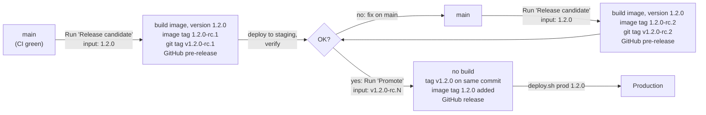

# Zappaloo – Software Architecture and Implementation Concept

**Claim:** Tiny world. Big moments.

**Platform description:** A playful digital world for shared experiences and special occasions.

> **How to read this document.** The prose describes the concept and architecture. Binding requirements are listed in a **Requirements** table at the end of each topic section. Requirement IDs follow the scheme `<PREFIX>-<nn>` (see [README.md](README.md)); they are never renumbered or reused. Priorities: **Must** (mandatory for the first production event), **Should** (expected, may be deferred with good reason), **Could** (optional).

---

# Contents

- [1. Project Vision](#1-project-vision)
- [2. Core Concept and User Experience](#2-core-concept-and-user-experience)
  - [2.1 Two Ways In](#21-two-ways-in)
  - [2.2 Connection Between Website and Game World](#22-connection-between-website-and-game-world)
  - [2.3 Where the Value Lies](#23-where-the-value-lies)
- [3. Game World](#3-game-world)
  - [3.1 Top-Down Pixel-Art World](#31-top-down-pixel-art-world)
  - [3.2 Representation of the Real Venues](#32-representation-of-the-real-venues)
  - [3.3 No Real-Time Multiplayer](#33-no-real-time-multiplayer)
  - [3.4 Interactive Objects and NPCs](#34-interactive-objects-and-npcs)
  - [3.5 Entering the Game, Controls and Movement](#35-entering-the-game-controls-and-movement)
  - [3.6 Guest Presence and Seating](#36-guest-presence-and-seating)
  - [3.7 Treasure Hunt](#37-treasure-hunt)
  - [3.8 Requirements](#38-requirements)
- [4. Minigames and Central Result Management](#4-minigames-and-central-result-management)
  - [4.1 Technical Implementation](#41-technical-implementation)
  - [4.2 Data Exchange Between Zappaloo and Minigames](#42-data-exchange-between-zappaloo-and-minigames)
  - [4.3 Central Minigame API](#43-central-minigame-api)
  - [4.4 Central Highscore Management](#44-central-highscore-management)
  - [4.5 Result Storage](#45-result-storage)
  - [4.6 Security and Tamper Protection](#46-security-and-tamper-protection)
  - [4.7 Playing During the Event](#47-playing-during-the-event)
  - [4.8 Requirements](#48-requirements)
- [5. Classic Website](#5-classic-website)
  - [5.1 Possible Pages and Content](#51-possible-pages-and-content)
  - [5.2 Responsive Design](#52-responsive-design)
  - [5.3 Language](#53-language)
  - [5.4 Event Screen](#54-event-screen)
  - [5.5 Now and Next](#55-now-and-next)
  - [5.6 Requirements](#56-requirements)
- [6. Shared Content and Data Base](#6-shared-content-and-data-base)
  - [6.1 Requirements](#61-requirements)
- [7. User Accounts, Avatars and RSVP](#7-user-accounts-avatars-and-rsvp)
  - [7.1 User Accounts](#71-user-accounts)
  - [7.2 Registration and Invitations](#72-registration-and-invitations)
  - [7.3 Avatar Editor](#73-avatar-editor)
  - [7.4 RSVP](#74-rsvp)
  - [7.5 Requirements](#75-requirements)
- [8. Roles and Permissions](#8-roles-and-permissions)
  - [8.1 VIP](#81-vip)
  - [8.2 Staff](#82-staff)
  - [8.3 Admin](#83-admin)
  - [8.4 Combining and Revoking Roles](#84-combining-and-revoking-roles)
  - [8.5 Platform Administration](#85-platform-administration)
  - [8.6 Requirements](#86-requirements)
- [9. VIP Invitation System](#9-vip-invitation-system)
  - [9.1 Properties of Personal Invitation Codes](#91-properties-of-personal-invitation-codes)
  - [9.2 Redeeming a Code](#92-redeeming-a-code)
  - [9.3 VIP Status After Redemption](#93-vip-status-after-redemption)
  - [9.4 VIP Assignment by an Admin](#94-vip-assignment-by-an-admin)
  - [9.5 Additional Persons](#95-additional-persons)
  - [9.6 Security](#96-security)
  - [9.7 Requirements](#97-requirements)
- [10. Sign-In and Anonymous Access](#10-sign-in-and-anonymous-access)
  - [10.1 Sign-In Required](#101-sign-in-required)
  - [10.2 No Self-Registration](#102-no-self-registration)
  - [10.3 Features That Add Data](#103-features-that-add-data)
  - [10.4 Opening the Platform](#104-opening-the-platform)
- [11. Access Control and Unlock Conditions](#11-access-control-and-unlock-conditions)
  - [11.1 Server-Side Enforcement](#111-server-side-enforcement)
  - [11.2 Requirements (Sections 10 and 11)](#112-requirements-sections-10-and-11)
- [12. Guest Groups](#12-guest-groups)
  - [12.1 Requirements](#121-requirements)
- [13. Contributions and Gallery](#13-contributions-and-gallery)
  - [13.1 QR Code Upload](#131-qr-code-upload)
  - [13.2 Upload Flow](#132-upload-flow)
  - [13.3 Anonymous and Signed-In Upload](#133-anonymous-and-signed-in-upload)
  - [13.4 Photo Security and Processing](#134-photo-security-and-processing)
  - [13.5 Photo Gallery and Publication](#135-photo-gallery-and-publication)
  - [13.6 Keepsakes](#136-keepsakes)
  - [13.7 Moderation](#137-moderation)
  - [13.8 Requirements](#138-requirements)
- [14. Map Editor: Tiled](#14-map-editor-tiled)
  - [14.1 Map Structure](#141-map-structure)
  - [14.2 Object Properties](#142-object-properties)
  - [14.3 Export and Import](#143-export-and-import)
  - [14.4 Map Importer](#144-map-importer)
  - [14.5 Template Map Set](#145-template-map-set)
  - [14.6 Requirements](#146-requirements)
- [15. Technology Stack](#15-technology-stack)
  - [15.1 Decision: TypeScript for the Backend](#151-decision-typescript-for-the-backend)
- [16. Frontend Architecture](#16-frontend-architecture)
- [17. Backend Architecture](#17-backend-architecture)
  - [17.1 Live Updates](#171-live-updates)
  - [17.2 API](#172-api)
- [18. Database and Data Model](#18-database-and-data-model)
  - [18.1 Event Reference](#181-event-reference)
  - [18.2 Requirements](#182-requirements)
- [19. Reusability and Event Configuration](#19-reusability-and-event-configuration)
  - [19.1 Basic Principle](#191-basic-principle)
  - [19.2 Event Files](#192-event-files)
  - [19.3 Event Data](#193-event-data)
  - [19.4 Configurability](#194-configurability)
  - [19.5 Installable App (PWA, decided 2026-11-11, stage 3.5)](#195-installable-app-pwa-decided-2026-11-11-stage-35)
  - [19.6 Footer: Copyright and License Notice (decided 2026-11-11, stage 3.5)](#196-footer-copyright-and-license-notice-decided-2026-11-11-stage-35)
- [20. Installation and Operating Model](#20-installation-and-operating-model)
  - [20.1 Later Multi-Event Extension](#201-later-multi-event-extension)
  - [20.2 Requirements (Sections 19 and 20)](#202-requirements-sections-19-and-20)
- [21. Hosting and Server Infrastructure](#21-hosting-and-server-infrastructure)
  - [21.1 Host Prerequisites](#211-host-prerequisites)
  - [21.2 HTTPS](#212-https)
  - [21.3 Published Ports](#213-published-ports)
- [22. Docker and Deployment](#22-docker-and-deployment)
  - [22.1 Persistent Data](#221-persistent-data)
  - [22.2 Backups](#222-backups)
- [23. GitHub and CI/CD](#23-github-and-cicd)
  - [23.1 Version Scheme](#231-version-scheme)
  - [23.2 Branches and CI](#232-branches-and-ci)
  - [23.3 Release Workflow](#233-release-workflow)
  - [23.4 Environments](#234-environments)
  - [23.5 Deployment](#235-deployment)
  - [23.6 Version Information](#236-version-information)
  - [23.7 Rollback](#237-rollback)
  - [23.8 Command-Line Interface](#238-command-line-interface)
  - [23.9 Requirements (Sections 21–23)](#239-requirements-sections-2123)
- [24. Security and Privacy](#24-security-and-privacy)
  - [24.1 Requirements](#241-requirements)
- [25. Performance, Scaling and Tests](#25-performance-scaling-and-tests)
  - [25.1 Performance Measures](#251-performance-measures)
  - [25.2 Test Areas](#252-test-areas)
  - [25.3 Requirements](#253-requirements)
- [26. Proposed Project Structure](#26-proposed-project-structure)
- [27. Summary of Architecture Decisions](#27-summary-of-architecture-decisions)
- [28. Development Strategy and Order of Work](#28-development-strategy-and-order-of-work)
  - [Release 1 (early): Invitations and RSVP — Stages 1–3.5](#release-1-early-invitations-and-rsvp--stages-135)
  - [Stage 1 – Walking Skeleton and Deployment](#stage-1--walking-skeleton-and-deployment)
  - [Stage 2 – Accounts, Roles and Access](#stage-2--accounts-roles-and-access)
  - [Stage 3 – RSVP and Waiting Page](#stage-3--rsvp-and-waiting-page)
  - [Stage 3.5 – Installable App (completes Release 1)](#stage-35--installable-app-completes-release-1)
  - [Stage 4 – Content and Website](#stage-4--content-and-website)
  - [Stage 5 – Game World and Map Importer](#stage-5--game-world-and-map-importer)
  - [Stage 6 – Living World](#stage-6--living-world)
  - [Stage 7 – Contributions and Event Screen](#stage-7--contributions-and-event-screen)
  - [Stage 8 – Minigames, Treasure Hunt and Highscores](#stage-8--minigames-treasure-hunt-and-highscores)
  - [Stage 9 – Event Readiness](#stage-9--event-readiness)
  - [Stage 10 – After the Event](#stage-10--after-the-event)
  - [Event Operation and Follow-Up (not a development stage)](#event-operation-and-follow-up-not-a-development-stage)
- [29. Guiding Idea and Core Principles of Zappaloo](#29-guiding-idea-and-core-principles-of-zappaloo)
  - [Zappaloo accompanies an event before, during and after](#zappaloo-accompanies-an-event-before-during-and-after)
  - [One platform, many individual worlds](#one-platform-many-individual-worlds)
  - [Core principles](#core-principles)
- [30. Out of Scope for the First Version](#30-out-of-scope-for-the-first-version)

---

# 1. Project Vision

Zappaloo is a reusable digital event platform that combines an interactive pixel-art game world with a classic event website.

The platform is meant to do more than provide information about a wedding or another private occasion: it accompanies guests and hosts before, during and after the event.

Zappaloo consists of two connected experiences:

1. **Interactive pixel-art game world — the core:** once the hosts have opened the platform, guests land after sign-in in a digital representation of the event venues. They explore it with their own avatar, discover objects, NPCs, minigames and small surprises, and meet the figures of the other guests. A speech bubble with photo, greeting and "How I know the couple" helps them get to know each other.
2. **Classic website — always one click away:** all important information about the event is accessible in a clear, responsive way, also without the game world.

Both parts use the same central data and content base. Information therefore only needs to be maintained once and is available both on the website and in the game world.

Zappaloo serves both sides of an event:

- **Guests** get information, a playful world, help getting to know each other, and a way to share their moments at the event.
- **Hosts** get a guest list they can plan with — RSVP, menus, allergies, seating — and a keepsake book of their guests' messages to take with them.

Zappaloo aims to create an experience that goes beyond an ordinary event website: it informs, connects people, entertains and preserves shared memories.

---

# 2. Core Concept and User Experience

## 2.1 Two Ways In

The platform offers two ways in. **The game world is the core experience:** once the hosts have opened the platform (10.4), guests land in the game world after sign-in. The classic website is one click away and contains all information. Direct links, e.g. upload links or links in emails, open their target page directly.

**Pixel-art game world**
- Top-down perspective.
- Individually customisable avatars.
- Figures of all attending guests walking around.
- Several connected areas.
- Interactive objects, NPCs and information points.
- Minigames and easter eggs.
- Speech bubbles that help guests get to know each other.

**Classic website**
- Responsive layout for desktop, tablet and smartphone.
- Event information.
- Programme and schedule.
- Venues and directions.
- Parking and accommodation.
- FAQ and contact information.
- Snapshots (photos with optional caption), gallery and keepsake page.
- Further event-related content.

The website must remain fully usable for anyone who does not want to use the game world.

## 2.2 Connection Between Website and Game World

The website and the game world are not independent products.

They use the same event data. Information stored for an NPC in the game world, for example, can also appear on a classic information page.

Examples:
- An NPC explains the schedule of the day.
- The same information is available on the website under "Programme".
- A building in the game world represents the actual venue.
- The corresponding website page contains the address, directions and other practical information.
- A minigame stores its results centrally in Zappaloo.
- A highscore list can be shown both in the minigame and on the website.

## 2.3 Where the Value Lies

Guests use the platform most around a few moments. The features are designed around them:

1. **Invitation:** the QR code on the printed card leads to redeeming the invitation and answering the RSVP. This works early, before the world is open; until then, guests see a waiting page (sections 7.4, 9, 10.4).
2. **Before the event:** once the hosts open the world, guests create their avatar and enter it. The world is populated by the figures of all guests who have accepted, walking around. Guests find their table and the programme (section 3.6).
3. **During the event:** guests share snapshots and keepsakes, also without an account. After a quick swipe moderation, snapshots appear on the event screen. They hunt QR codes hidden at the venue and play the couple quiz, with rankings on the event screen (sections 3.7, 5.4).
4. **After the event:** the gallery and the keepsake page keep the memories until shutdown, and the hosts keep the printable keepsake book (sections 13, 24).

---

# 3. Game World

## 3.1 Top-Down Pixel-Art World

The game world is shown in a classic top-down perspective.

Guests move their personal avatar through a digital world modelled on the actual event venues.

The environment consists of:
- Paths and squares.
- Buildings and interiors.
- Plants, trees and decorations.
- Furniture and items.
- NPCs and interactive objects.
- Transitions between areas.

The game world should have its own visual character and invite exploration.

## 3.2 Representation of the Real Venues

The digital areas follow the actual sequence of the event.

Example for a wedding:

1. Church
2. Garden for the aperitif
3. Banquet hall for dinner
4. Party area

The areas are connected in a logical order.

The game world can be fully explored before the event. By default it is not automatically locked or unlocked according to the real schedule.

## 3.3 No Real-Time Multiplayer

There is no real-time multiplayer. Guests are rarely online at the same time, and real-time synchronisation is the most expensive part of a game world. Instead, the world comes alive through the figures of all attending guests walking around (see 3.6).

Each player's game runs on its own. The server provides maps, content and data, but no shared game state.

## 3.4 Interactive Objects and NPCs

The game world contains several kinds of interactive objects.

Examples:
- NPCs with dialogues.
- Information signs.
- Buildings with further information.
- Items with easter eggs.
- Transitions to other areas.
- Clickable objects that open website pages or start minigames.

Objects are defined through generic types (decided 2026-11-10):

- `portal`: leads to another map (scene) at a spawn point. Shown as a wobbling arrow.
- `clickable`: an object the player can activate, e.g. a building, an NPC, a sign or an item. Its action is one of: open a website page as an overlay (e.g. programme, RSVP, upload, table finder), show a content item shared with the website, show a dialogue (e.g. an NPC conversation), or start a minigame.
- `decoration`: no interaction.

The world of an event is drawn in Tiled and can consist of several maps (scenes). Objects and portals are placed in Tiled (see section 14). A clickable object's action can be preset in Tiled, and the admin assigns or changes it per map in the admin view "Spielwelt" without re-importing the map (MAP-15). Portal targets come only from Tiled.

The game experience is the core of Zappaloo. A clickable object that opens a website page therefore does not leave the game: the page opens as an overlay above the paused game, and closing it returns the player to the same position.

## 3.5 Entering the Game, Controls and Movement

**Entering the game.** Once the platform is open (10.4), the guest lands in the game world after sign-in (see 2.1). Many guests come mainly for practical information, so the game must not get in their way:

- On the first entry into the world, the guest is guided: create the avatar (also for their accompanying persons), optionally add a profile photo and greeting, answer the RSVP in an overlay if not yet done, then play freely.
- A bar with buttons for Programme, RSVP, Upload and Website is always visible at the top of the game; "Website" returns to the classic website with one click. While the RSVP is open, the RSVP button shows a badge. There are no other buttons on top of the game, and the game shows no event-day "now / next" (decided 2026-11-10).
- Everything else is reached through the world itself: clickable objects sparkle briefly at random intervals. Clicking or tapping one walks the avatar to the object's approach point, and when it arrives the object's action runs, e.g. the church opens the programme, the restaurant the table finder. On desktop, Enter or Space activates the object in front of the avatar. Portals to other maps are shown as wobbling arrows. Clicking the own avatar opens the profile. At the first entry, a hint ("Tippe auf Dinge, die funkeln") is shown until the first object is used.
- The game is playable quickly on a phone: the first map loads within 5 seconds over 4G, and other maps load in the background.

**Movement.** Avatars move smoothly in all directions, not tile by tile.

- **Desktop:** arrow keys; pressing two keys moves diagonally.
- **Smartphone and tablet:** tap-to-move. The client computes a path around the map's collision areas and the avatar walks it.

Avatars collide with the collision areas of the map. Wandering guest figures (3.6) don't block the player: the avatar passes through them.

## 3.6 Guest Presence and Seating

The world is populated by the figures of all attending guests:

- Every VIP — including accompanying persons — who has accepted the RSVP for at least one event part and has an avatar appears as a figure with a name tag. Guests who haven't answered or have declined don't appear. That is also a reason to answer the RSVP.
- Figures walk around randomly inside the wander areas of the maps that belong to the event parts the guest attends. An aperitif-only guest walks in the garden, not in the banquet hall.
- The signed-in user sees their own controllable avatar, not their own figure.
- Figures and name tags are shown only to signed-in users. A guest cannot hide their own figure (decided 2026-11-10).
- Each device only simulates the figures on the current map. Random movement doesn't need to match across devices.

Accompanying persons (see 7.4) have no account, but they do get a figure: their VIP selects or designs its avatar in the avatar editor.

**Getting to know each other.** At weddings, many guests don't know each other. The world helps:

- A VIP can add an optional **profile photo**, an optional one-line **greeting**, e.g. "Hi, nice to meet you!", and an optional **"How I know the couple"**. For "How I know the couple", the VIP picks an option from a list, e.g. "Friends of the bride", and/or writes a free line, e.g. "Flatmate from Bern". The admin defines the list per event, so the platform also works for other occasions. For accompanying persons, the VIP decides explicitly whether to add them.
- When the player comes close to a wandering figure, the figure stops and its **speech bubble** opens automatically. It shows name, profile photo, greeting and "How I know the couple", with the chosen list option as a small badge. If several figures are close, only the nearest one's bubble opens.
- The bubble closes when the player walks away. Clicking or tapping the bubble keeps it open until the player closes it.
- Profile photos and lines are not moderated: only invited VIPs have profiles. As a safety net, the admin can remove any profile photo or line.
- The avatar is not generated from the photo. The photo is only shown in the speech bubble and the table finder.

The admin assigns guests to tables. Seats are map objects (see 14.2). By default, accompanying persons sit at their VIP's table. The admin can override every seat assignment. Guests can look up their table on the website ("Where do I sit?") and in the game world, together with their tablemates' names, profile photos, greetings and "How I know the couple". The admin decides when the seating plan becomes visible, e.g. only on the event day.

## 3.7 Treasure Hunt

A treasure hunt connects the real venue with the game world:

- The admin creates hunt items: name, hint, collectible graphic, and optionally a game area or content that the item unlocks.
- Each item gets a QR code with a unique, random token. The codes are printed and hidden at the venue.
- A signed-in guest scans a code and collects the item. A guest who isn't signed in signs in first.
- Collected items are shown in the guest's profile and in the game world.
- A ranking (items found, ties broken by the time of the last find) is shown on the website and on the event screen (5.4).
- The hunt can be limited to a time window, e.g. the party evening.

## 3.8 Requirements

| ID | Requirement | Prio |
|---|---|---|
| GAME-01 | The game world is rendered in the browser as a top-down pixel-art world using Phaser. | Must |
| GAME-02 | Avatars move smoothly in all directions and collide with the collision areas of the map; the camera follows the player's avatar. | Must |
| GAME-03 | The world consists of several maps (areas) that are connected in a logical order via portals. | Must |
| GAME-04 | The whole world can be explored before the event; by default no area is locked or unlocked automatically according to the real schedule. | Must |
| GAME-05 | Map objects are defined through the generic types `portal` (leads to another map at a spawn point), `clickable` (an object the player can activate) and `decoration` (no interaction); their behaviour is determined by type and configuration (14.2, decided 2026-11-10). | Must |
| GAME-06 | Activating a clickable object runs its action: open a website page as an overlay, show a content item shared with the website, show a dialogue, or start a minigame; a portal leads to another map at a spawn point. | Must |
| GAME-07 | Controls and display of the game world are suitable for the intended screen sizes (desktop and smartphone). | Must |
| GAME-08 | The world can contain easter eggs (hidden interactive objects with special content). | Could |
| GAME-09 | On desktop, the avatar is controlled with the arrow keys; pressing two keys moves diagonally. | Must |
| GAME-10 | On touch devices, the avatar is controlled by tap-to-move: the client computes a path around the map's collision areas and the avatar walks it. | Must |
| GAME-11 | A website page opened from the game (button bar or clickable object) opens the page as an overlay above the paused game; closing the overlay returns the player to the game at the same position. | Must |
| GAME-12 | Once the platform is open (ACS-10), the user lands in the game world after sign-in; the classic website is reachable with one click from the game; direct links (upload links, links in emails) open their target page directly. | Must |
| GAME-13 | On the first entry into the world, the guest is guided: create the avatar (also for their accompanying persons), optionally add a profile photo and greeting, answer the RSVP in an overlay if not yet done, then play freely. | Must |
| GAME-14 | A bar with buttons for Programme, RSVP, Upload and Website is always visible at the top of the game; while the guest's RSVP is open, it shows a badge; there are no further buttons on top of the game. | Must |
| GAME-15 | Clickable objects sparkle briefly at random intervals, and portals are shown as wobbling arrows, so players see what they can use (decided 2026-11-10). | Must |
| GAME-16 | Clicking or tapping a clickable object or a portal walks the avatar to the object's approach point; when it arrives, the action runs; on desktop, Enter or Space activates the object the avatar stands in front of. | Must |
| GAME-17 | On the first entry, a short hint ("Tippe auf Dinge, die funkeln") is shown until the player activates the first object. | Should |
| GAME-18 | Clicking or tapping the player's own avatar opens the profile as an overlay. | Could |
| MP-01 | ~~Each map is a separate multiplayer room managed by the server.~~ (withdrawn: no multiplayer, see 3.3) | – |
| MP-02 | ~~Players on the same map see the avatars and movements of the other players in that room in near real time.~~ (withdrawn: no multiplayer, see 3.3) | – |
| MP-03 | ~~Passing through a portal moves the player from the current room to the target map's room at the configured target spawn point.~~ (withdrawn: no multiplayer; portals are covered by GAME-06) | – |
| MP-04 | ~~Each client simulates its own avatar's movement; the server validates every position update (speed within the limit, no crossing of collision areas, inside the map) and, if a check fails, keeps the last valid position and sends it back to the client.~~ (withdrawn: no multiplayer, see 3.3) | – |
| MP-05 | ~~The movement of other players is interpolated between server updates so that it appears smooth.~~ (withdrawn: no multiplayer, see 3.3) | – |
| MP-06 | ~~There are no collisions between players; avatars can pass through each other.~~ (withdrawn: no multiplayer, see 3.3) | – |
| PRES-01 | Every VIP (including accompanying persons) who has accepted the RSVP for at least one event part and has an avatar appears in the game world as a figure with a name tag; others don't appear; the signed-in user sees their own avatar instead of their own figure. | Must |
| PRES-02 | Figures walk around randomly inside the wander areas (`type = wander`) of the maps whose `eventPart` the guest attends, respecting the map's collision areas. | Must |
| PRES-03 | ~~When a guest is online, their static figure is replaced by their live avatar.~~ (withdrawn: no multiplayer, see 3.3) | – |
| PRES-04 | Figures and name tags are shown only to signed-in users (decided 2026-11-10: a guest cannot hide their own figure). | Must |
| PRES-05 | The admin assigns guests to tables; seats are map objects (`type = seat`, property `table`) and the server places each guest on a free seat of their table. | Must |
| PRES-06 | A signed-in guest can look up their table on the website ("Where do I sit?") and in the game world; the admin sets when the seating plan becomes visible. | Must |
| PRES-07 | Accompanying persons get a figure whose avatar their VIP selects or designs in the avatar editor; they occupy seats in the seating plan, by default at their VIP's table (the admin can override this), and appear in the table finder. | Must |
| PRES-08 | Each device simulates only the figures on the current map; random movement doesn't need to match across devices. | Should |
| PRES-09 | A VIP can add an optional profile photo and an optional one-line greeting (limited length), also for their accompanying persons; both can be changed or deleted at any time; the photo is validated and processed like contribution photos. | Must |
| PRES-10 | When the player comes close to a wandering figure, the figure stops and its speech bubble opens automatically, showing name, profile photo, greeting and "How I know the couple"; if several figures are close, only the nearest one's bubble opens; the bubble closes when the player walks away, unless the player has clicked or tapped it, which keeps it open until closed. | Must |
| PRES-11 | ~~Profile photos and greetings go through the moderation queue and are visible to others only after approval.~~ (withdrawn: profiles are not moderated, see PRES-14) | – |
| PRES-12 | The table finder shows the guest's tablemates with name, profile photo, greeting and "How I know the couple". | Should |
| PRES-13 | A VIP can add an optional one-line "How I know the couple" (limited length), also for their accompanying persons; it is shown in the speech bubble and the table finder and, like the greeting, not moderated. | Should |
| PRES-14 | Profile photos and lines are shown without moderation; the admin can remove any profile photo or line. | Must |
| PRES-15 | For "How I know the couple", a VIP can choose an option from a list in addition to the free line; the admin defines the list per event (wedding default: bride's family, groom's family, friends of the bride, friends of the groom, friends of both, colleagues); the chosen option is shown as a badge in the speech bubble and the table finder. | Should |
| HUNT-01 | The admin can create treasure hunt items (name, hint, collectible graphic) and export each item's QR code for printing. | Should |
| HUNT-02 | Each hunt item's QR code contains a unique, random token that cannot be guessed; scan attempts are rate-limited. | Should |
| HUNT-03 | A signed-in guest who scans a hunt item's QR code collects the item once; a guest who isn't signed in is led through sign-in first. | Should |
| HUNT-04 | Collected items are shown in the guest's profile and in the game world. | Should |
| HUNT-05 | A found hunt item can be used as an access condition that unlocks a game area or content (see ACS-05). | Should |
| HUNT-06 | A treasure hunt ranking (items found, ties broken by the time of the last find) is shown on the website and on the event screen. | Should |
| HUNT-07 | The admin can limit the hunt to a time window; scans outside it are not counted. | Should |

---

# 4. Minigames and Central Result Management

Minigames are a separate part of Zappaloo. They do not work in isolation; they communicate with the central platform.

## 4.1 Technical Implementation

Minigames are implemented as separate Phaser scenes.

Minigames ship with the platform: their code and their content (questions, tasks, levels) are part of the platform code and change only with a deployment. Each minigame is registered under a unique `minigameId`. In the game world, a minigame is started through a portal whose `minigameId` property names that minigame.

When a minigame starts:
1. The current game world is paused.
2. The minigame is started as its own scene.
3. Zappaloo provides the necessary data.
4. The minigame runs independently of the main world movement.
5. When it ends, the minigame is closed.
6. The main world resumes at the previous position.

This allows different minigames to be developed without changing the underlying game world.

## 4.2 Data Exchange Between Zappaloo and Minigames

Data exchange must work in both directions.

**Zappaloo passes to a minigame:**
- User ID.
- User name.
- Avatar or relevant profile information.
- Event ID and event information.
- Minigame ID.
- Existing results and progress, where relevant.

Only the data that the minigame actually needs is passed.

**A minigame passes to Zappaloo:**
- Score.
- Game result.
- Time taken.
- Number of attempts.
- Answers and quiz results.
- Collected items.
- Progress.
- Achievements.
- Other minigame-specific results.

The platform must not be limited to one particular minigame format. The result structure must therefore be sufficiently flexible.

## 4.3 Central Minigame API

Communication goes through a central minigame API, i.e. a dedicated backend module.

This module is responsible for:

- Providing the required user and event data.
- Providing existing results and progress.
- Accepting new results.
- Validating submitted results on the server.
- Storing results.
- Computing personal bests.
- Building highscore lists and leaderboards.
- Making results available to other parts of the platform.

Minigames do not access the database directly. They communicate with the backend through the designated interfaces.

## 4.4 Central Highscore Management

Highscores are managed centrally by Zappaloo and not stored or computed separately by each minigame.

Leaderboards can therefore be shown in several places:

- Directly inside a minigame.
- As a leaderboard on the classic website.
- On the event screen at the venue, updated live (5.4).
- As an information panel in the game world.
- As personal statistics of a user.

Possible views:
- Best results of an event.
- Personal best.
- Current rank of a player.
- Top players of a minigame.
- Number of attempts played.
- Further statistics.

The platform should support multiple attempts per user. Both the best result and the individual attempts can be stored.

## 4.5 Result Storage

A result record must contain at least:

| Field | Description |
|---|---|
| `eventId` | Associated event |
| `userId` | Player |
| `minigameId` | Associated minigame |
| `score` | Score achieved |
| `duration` | Play time |
| `resultData` | Further results and metadata |
| `createdAt` | Time of storage |

The structure can be extended with further fields if needed.

The data must be structured so that different minigames can store their own results without a separate database structure per minigame.

## 4.6 Security and Tamper Protection

Submitted results must not be accepted blindly as correct.

The backend must check at least:
- Is the user authenticated?
- Does the user belong to the event?
- Is the minigame accessible to this user?
- Is the submitted minigame ID valid?
- Are score, duration and results plausible?
- Is the submission allowed for this attempt?

Protection is proportionate to a private event:

- Every attempt starts with a server-issued attempt ID; a result is accepted only for an open attempt of the same user.
- Each minigame defines a plausibility profile, e.g. maximum score and minimum duration, which the server checks.
- For quizzes, answers are checked on the server and the correct answers are never sent to the client.

## 4.7 Playing During the Event

Minigames gain most value when many guests play at the same time in the same room, e.g. the couple quiz during the party. Guests then play on their smartphones. During the party they won't walk through the game world to find the portal, so a minigame can also be started directly from a website page or a QR code.

## 4.8 Requirements

| ID | Requirement | Prio |
|---|---|---|
| MG-01 | Minigames run as separate Phaser scenes; the game world is paused when a minigame starts and resumes at the previous position when it ends. | Must |
| MG-02 | The platform passes to a minigame only the data it needs, from: user ID, user name, avatar/profile info, event ID and info, minigame ID, and existing results/progress. | Must |
| MG-03 | A minigame submits its results through the central minigame API; the result structure is flexible (score, result, duration, attempts, answers, items, progress, achievements, minigame-specific data). | Must |
| MG-04 | Minigames never access the database directly; all reads and writes go through backend interfaces. | Must |
| MG-05 | Each result record contains at least `eventId`, `userId`, `minigameId`, `score`, `duration`, `resultData` and `createdAt`; all minigames share one generic storage structure. | Must |
| MG-06 | Multiple attempts per user are supported; individual attempts are stored and the personal best is derived from them. | Must |
| MG-07 | The server rejects a result submission unless the user is authenticated, belongs to the event, may access the minigame, the minigame ID is valid, score/duration/results are plausible, and the submission is allowed for this attempt. | Must |
| MG-08 | Each attempt starts with a server-issued attempt ID and a result is accepted only for an open attempt of the same user; the server checks each minigame's plausibility profile (e.g. maximum score, minimum duration); quiz answers are checked on the server and correct answers are never sent to the client. | Must |
| MG-09 | Highscores are managed centrally: best results of the event, personal best, current rank, top players per minigame and number of attempts. | Must |
| MG-10 | Leaderboards can be shown inside a minigame, on the website, as an information panel in the game world, and as personal statistics. | Should |
| MG-11 | Minigames, including their content, ship with the platform code and are registered under a unique `minigameId`; clickable objects reference a minigame by its `minigameId`. | Must |
| MG-12 | Minigames are playable on smartphones with touch input. | Should |
| MG-13 | A minigame can be started directly from a website page or a QR code, without walking to its object in the game world. | Should |

---

# 5. Classic Website

The website is a full part of the platform, not just an add-on to the game world.

It must work independently of Phaser and make all important information accessible.

## 5.1 Possible Pages and Content

- Home page.
- Event description.
- Programme and schedule.
- Venues.
- Travel and directions.
- Parking.
- Accommodation.
- FAQ.
- Contact.
- Guest information.
- Upload of snapshots and keepsakes.
- Gallery.
- Keepsakes.
- Highscore and minigame overviews.
- Further event-related pages.

The actual pages and content can differ per event.

## 5.2 Responsive Design

The website must work well on:
- Smartphones.
- Tablets.
- Desktop computers.

Contribution upload is optimised especially for smartphones.

The game world can also be opened in the browser. Its controls and display must suit the intended screen sizes.

## 5.3 Language

The UI is in German. Translation is planned from the start: all UI strings are externalised through an i18n framework, and every content item is stored with a language key (see section 6). Further languages can then be added without code changes.

## 5.4 Event Screen

The event screen is a full-screen page for a projector or TV at the venue. It needs no interaction and rotates between panels:

- **Photo wall:** newly approved snapshots, with their caption if any, appear within seconds of approval. In between, a slideshow of recent snapshots runs. Keepsakes are not shown on the wall.
- **Minigame leaderboards:** e.g. the couple quiz, updated live while guests play.
- **Treasure hunt ranking.**

The admin chooses the active panels and the rotation interval. Only approved content appears on the screen (see 13.7).

Per screen link, the admin can choose an upload link. Its QR code then appears in the bottom-right corner for 15 seconds every 2 minutes, over every panel, so guests can join in from the projector without the QR code taking space permanently (decided 2026-11-10).

The screen is opened through a read-only screen link created by the admin. The link grants access to the event screen only and can be revoked. This avoids leaving an admin session open on a venue laptop.

## 5.5 Now and Next

On the event day, guests mostly want to know: what is happening now, and what comes next?

- The schedule is stored as structured entries: start time, optional end time, title, place, and optionally the map that represents the place.
- On the event day, the website start page shows the current and the next entry, in the event's timezone. The game world shows no "now / next" (decided 2026-11-10).
- The programme shows a guest only the event parts they are invited to, with one line saying so.
- Changes to the schedule by the admin are visible immediately, e.g. when dinner starts later.
- If an entry has a map, "Go there" opens that map in the game.

## 5.6 Requirements

| ID | Requirement | Prio |
|---|---|---|
| WEB-01 | The website is fully usable without the game world and does not depend on Phaser. | Must |
| WEB-02 | The website provides pages for: home, event description, programme/schedule, venues, travel/directions, parking, accommodation, FAQ, contact and guest information. | Must |
| WEB-03 | The set of pages and their content is configurable per event. | Must |
| WEB-04 | The website renders and is usable on smartphones, tablets and desktop computers. | Must |
| WEB-05 | The website offers highscore and minigame overview pages. | Should |
| WEB-06 | The website gives access to contribution upload, the gallery and the keepsake page (see PHO). | Must |
| WEB-07 | The schedule is stored as structured entries (start time, optional end time, title, place, optional map); on the event day, the website start page shows the current and the next entry in the event's timezone, and schedule changes are visible immediately; the game world shows no "now / next" (decided 2026-11-10). | Should |
| WEB-08 | A schedule entry with a map offers "Go there", which opens that map in the game. | Could |
| WEB-09 | The programme shows a guest only the event parts they are invited to, with one line saying so. | Should |
| LANG-01 | All UI strings are externalised through an i18n framework; German is the default and initially only UI language. | Must |
| LANG-02 | Every content item (pages, dialogues, NPC texts, information objects) is stored with a language key; initially only German (`de`) is maintained. | Must |
| SCR-01 | A full-screen event screen rotates between the active panels (photo wall, minigame leaderboards, treasure hunt ranking) without user interaction; the admin chooses the panels and the rotation interval. | Must |
| SCR-02 | The photo wall shows an approved snapshot (with its caption, if any) within a configurable time after approval (default 10 seconds) and otherwise a slideshow of recent approved snapshots; keepsakes are not shown on the wall. | Must |
| SCR-03 | ~~The admin sets whether photos appear on the photo wall immediately after upload or only after approval.~~ (withdrawn: everything on the screen is moderated, see MOD-01) | – |
| SCR-04 | The event screen is opened through a read-only screen link created by the admin; the link grants access to nothing but the event screen and can be revoked. | Must |
| SCR-05 | Minigame leaderboards on the event screen update live while guests play. | Should |
| SCR-06 | ~~The event screen can show approved guestbook entries as a panel.~~ (withdrawn: merged into the wall, see SCR-01, PHO-15) | – |
| SCR-07 | Per screen link, the admin can choose an upload link; the event screen then shows its QR code in the bottom-right corner over every panel for 15 seconds every 2 minutes; without a chosen link no QR code is shown. | Should |

---

# 6. Shared Content and Data Base

Website and game world use the same central event data base.

Content must not have to be maintained twice.

Example content areas:
- Event information.
- Schedule.
- Places and addresses.
- Dialogues.
- NPC texts.
- Information objects.
- FAQ.
- Website pages.
- Photo albums.
- Unlock conditions.

The data is stored in a structured way and served by the backend.

Website pages and other texts are edited in the browser using Markdown with a preview, by admins and by staff with `editWebsiteContent`. Changes are live without a redeployment. Rendered Markdown is sanitised.

A piece of content may be presented differently depending on context. A venue, for example, can appear as an information page on the website and as an interactive building in the game world.

The platform therefore separates:
- Content and data.
- Presentation on the website.
- Presentation in the game world.
- Interaction logic.

## 6.1 Requirements

| ID | Requirement | Prio |
|---|---|---|
| CNT-01 | Website and game world use one central event content base; each piece of content is maintained once. | Must |
| CNT-02 | The content base covers event information, schedule, places/addresses, dialogues, NPC texts, information objects, FAQ, website pages, photo albums and unlock conditions. | Must |
| CNT-03 | Content is separate from its presentation; the same content item can be shown as a website page and referenced from a game-world object (e.g. via `contentId`). | Must |
| CNT-04 | Content is stored in a structured form and served through the backend API. | Must |
| CNT-05 | Admins and staff with `editWebsiteContent` edit website pages and other content texts in the browser using Markdown with a preview; changes are live without a redeployment. | Must |

---

# 7. User Accounts, Avatars and RSVP

## 7.1 User Accounts

Guests get an account by redeeming their invitation (see 7.2) and sign in.

Planned functions:
- Invitation redemption.
- Login and logout.
- Optional email verification.
- Password reset.
- User profile.
- Management of one's own avatar.
- Event memberships and roles.

Authentication is done on the server through secure sessions.

Passwords are stored only using a suitable password-hashing algorithm.

Since the whole platform requires sign-in (see section 10), sessions stay valid for a long time, so guests rarely need to sign in again.

**Email**

- Emails (verification, password reset, "the door is open", shutdown notice) are sent through an SMTP provider configured per installation. Infomaniak mail is used for the first installation (proof of concept).
- Accounts are created by redeeming an invitation (printed card with QR code) or by an admin, and need no verification. Their email status stays `unverified` until the user verifies it voluntarily from the profile.
- Password reset by email is only offered for verified addresses. Otherwise a mistyped address would let a stranger take over the account. Users without a verified address ask an admin, who can create a one-time password-reset link and hand it over.

Users can delete their own account and their own content at any time.

### 7.1.1 Accounts, Sessions and Links (decided 2026-11-10)

**Accounts.** One account (`users`) is global, not tied to an event; its roles belong to an event membership (`memberships`, role rows `vip`, `staff`, `admin`, combinable; 8, 20.1).
- `username` is the login name: 3–32 characters from `a–z`, `0–9`, `.`, `_`, `-`, stored in lower case, compared case-insensitively, never changed.
- `displayName` (1–100 characters) is the name other guests see; the user can change it, it starts as the username (or the name an admin gave).
- `email` is optional; it is `unverified` until the user verifies it (step 2c).
- The profile holds display name, email and password. Photo, greeting and the other profile items come with their features.
- A new account has no password until its owner sets one through a one-time setup link.

**Passwords** (ACC-06). Hashed with **argon2id** (library `@node-rs/argon2`, parameters m = 19 MiB, t = 2, p = 1, random salt; the hash string carries its parameters). A password has 10–128 characters and must not equal the username, ignoring case (`400 password_is_username`); there are no composition rules. Setting or changing a password ends all other sessions of that user and voids its open setup and reset links.

**Sessions** (ACC-05, ACC-13). Server-side table `sessions`; the browser holds only a random 32-byte token in the cookie `zappaloo_session` (`HttpOnly`, `SameSite=Lax`, `Path=/`, `Secure` in staging and prod), signed with `SESSION_SECRET`; the database stores only the SHA-256 of the token. A session lasts 365 days and is renewed on use (at most once a day), so active guests never sign in again; logout deletes it. `SESSION_SECRET` is read from the environment or from `SESSION_SECRET_FILE` (`secrets/session_secret`, 23.5); it has at least 32 characters and is required in staging and prod.

**CSRF** (SEC-01). Every session has a CSRF token, returned by `GET /api/session`; every `POST`, `PUT`, `PATCH` and `DELETE` with a session must send it in the header `X-CSRF-Token`. Independently, a request with an `Origin` header whose host differs from the `Host` header is refused. Both failures answer `403 csrf_failed`.

**Rate limiting** (SEC-02). The limits per client address count only failed attempts (decided 2026-11-10): many guests share one address (the venue's Wi-Fi, a mobile network), and only failures help a guesser. Login: at most 20 failed attempts per client address and 5 per account in 15 minutes, whether it is named by username or by email address (ACC-16; a name that matches no account has its own count; a success clears the account's count); setting a password with a link: 10 unknown, used or expired links per client address in 15 minutes; confirming an email address: the same, with its own counter. An exceeded limit answers `429 rate_limited` with `Retry-After`. The counters live in memory (one process). The client address comes from `X-Forwarded-For` only if `TRUST_PROXY=true` (set in the Compose file, where Caddy is the only way in). Invitation redemption has its limits in 9.6.1; uploads get theirs with their feature.

**Sign-in by email** (ACC-16, decided 2026-11-10). The login field takes a username or an email address. An email address signs in only if it is verified, and an address can be verified by one account only: verifying fails with `409 email_taken` if another account has already verified it. An unverified address never signs anyone in, so a typo or someone else's address cannot lock out or impersonate a guest. The email stays optional, also when redeeming an invitation, because some guests (e.g. grandparents) have none.

*Implementation (step 3e):* `POST /api/session` keeps the field name `username`, which holds a username or an address (up to 254 characters). The address is compared in lower case after trimming; usernames never contain `@`, so the two cannot be mixed up. An unknown name, an unverified address and a wrong password all give the same `401 invalid_credentials` after the same hashing work. The limits count failures under the typed name (five per name and 15 minutes, 20 per client address), so an address and a username of one account are counted separately. Uniqueness is checked when the address is verified (`POST /api/email/verify`: `409 email_taken`, the link stays unused and works again once the address is free) and enforced by a unique index on the lower-cased address of verified accounts (`users_verified_email`); unverified addresses may repeat. Changing or removing an address makes it unverified again, so it stops signing in; deleting the account frees it. Sending the verification mail does not check for another account, so nobody can probe whether an address is taken without owning its mailbox.

**Login errors** do not reveal whether a username exists: unknown user and wrong password give the same `401 invalid_credentials`, after the same amount of hashing work.

**One-time links.** A setup link (new account, ACC-14) or reset link (ACC-10, ACC-15) holds a random token, stored only as SHA-256 with its purpose, user, expiry (24 hours) and use; it works once. The URL is `<PUBLIC_URL>/set-password/<token>`; `PUBLIC_URL` (default `http://localhost:5173` in dev and test) is derived from `SITE_ADDRESS` and `HTTPS_PORT` in the Compose file, and only its origin is used, so the default port never appears in a link or on a printed card (`https://example.org:443` gives `https://example.org`). Using a link sets the password and ends the user's sessions. Using a link, changing the password or changing the email address marks all other open setup and reset links of the user as used (decided 2026-11-10), so a link that went to an old address, or was handed over and not needed, cannot take the account over later. The link is checked before the password is hashed. Expired sessions and used or expired links are deleted at startup and once a day, so no address is kept longer than needed.

**Mail** (ACC-11, decided 2026-11-10). Configured per installation by `SMTP_HOST`, `SMTP_PORT` (default 587), `SMTP_USER`, `SMTP_PASSWORD` or `SMTP_PASSWORD_FILE` (`secrets/smtp_password`, which `deploy.sh` passes as a Compose secret, 23.5) and `MAIL_FROM` (required with `SMTP_HOST` in staging and prod; empty values count as unset). In staging and prod `SMTP_USER` without a password stops the start, and `deploy.sh` refuses `SMTP_USER` without `secrets/smtp_password`, so a login never fails silently on every email. Port 465 uses TLS from the start; otherwise STARTTLS, which is required when a login is configured. Without `SMTP_HOST` no email is sent: verification answers `503 mail_unavailable`, and a password-reset request answers as usual without sending. The emails are plain text.

**Email verification** (ACC-09). `POST /api/profile/email/verify` mails a link `<PUBLIC_URL>/verify-email/<token>` to the profile's unverified address (3 per hour and user); the page asks for a click on "Confirm address" and then posts the token to `POST /api/email/verify` (a button, not on opening the page: a mail provider's link scanner, or React running effects twice in development, would otherwise use the link up). The link is a one-time link with purpose `verify` (24 hours, single use) that remembers the address it was sent to and counts only while the profile still has that address. A verify link cannot set a password. Changing or removing the address makes it `unverified` again.

**Password reset by email** (ACC-03). `POST /api/password/forgot` takes a username or an email address and always answers `204`, so it does not reveal which accounts or addresses exist. Only accounts whose address is `verified` get a reset link by email (at most 3 mails per account and hour, counted in memory; links an admin or the CLI hands out do not count; 10 requests per client address in 15 minutes, `429` beyond). The mail is sent without the answer waiting for it. Nobody is signed in, so the link is audited with the actor `anonymous`. The link is the one of 7.1.1 (`/set-password/<token>`).

**Admin reset link** (ACC-10). `POST /api/admin/users/:id/reset-link` (admin role) returns the one-time reset URL and its expiry; audit log entry `link.create`. The admin user-management page comes later; until then the endpoint serves the API.

**Deleting the own account** (ACC-12). `DELETE /api/profile` with the current password deletes the user with membership, roles, sessions and links in one transaction; the audit log keeps only the user id (`user.delete`). Every audit entry holds ids only, never usernames, guest names or addresses, so nothing about a deleted account stays in the log (SEC-04). The last admin of the event cannot delete the account (`409 last_admin`). Deleting one's own contributions is added with the contributions in stage 7; accompanying persons with stage 3.

**Roles, capabilities and groups** (step 2d, decided 2026-11-10). `GET /api/admin/users` lists the accounts of the event with roles, capabilities and groups. `PUT /api/admin/users/:id/roles` replaces the complete set of roles (ROLE-01); roles left in the set stay as they are, so revoking one never touches another (ROLE-09). The last admin of the event keeps the role (`409 last_admin`). `PUT /api/admin/users/:id/capabilities` replaces the capabilities of a staff member (`409 not_staff` otherwise); the fixed list is `editWebsiteContent` and `moderateContributions`; `User.capabilities` shows them, and revoking `staff` clears them, so they do not come back with a later `staff`. The guards `requireRole` and `requireCapability` check exactly: an admin passes neither a `vip`, a `staff` nor a capability check unless they also have it (ROLE-08). Guest groups (`guest_groups`, `guest_group_members`): a name of 1–60 characters, unique per event regardless of case; any member of the event can be in a group, whatever the roles; `GET`/`POST /api/admin/groups`, `PATCH`/`DELETE /api/admin/groups/:id`, `PUT`/`DELETE /api/admin/groups/:id/members/:userId`. Deleting a group or an account removes the memberships. `GroupService.isInGroup` is what the access conditions use (ACS-05, step 2f). All changes go to the audit log. The admin page is Konten & Rollen (8.3, step 2h).

**API.** `GET /api/session` (current user or none, with the CSRF token), `POST /api/session` (login), `DELETE /api/session` (logout), `GET`/`PATCH /api/profile`, `POST /api/profile/password`, `POST /api/password/set` (with a link), `POST /api/admin/users` (admin role of the event: creates an account with roles and its setup link in one transaction and returns the link, ACC-08); roles, capabilities and groups below. Every response carries `Referrer-Policy: same-origin`, and the request log shows invitation codes and link tokens in URLs as `[redacted]` (INV-02).

## 7.2 Registration and Invitations

There is no public self-registration. An account is created only:
- by redeeming a personal invitation (link or code), or
- by an admin.

VIPs can request accompanying persons without an account, e.g. children (see 7.4).

Guests without an account can still contribute through the upload links at the venue (see 10.3, 13.3).

A user may already have an account and redeem an invitation later.

In that case the existing account is used. No second account is created.

## 7.3 Avatar Editor

Every signed-in user can design their own pixel-art avatar.

Possible customisations:
- Skin colour.
- Hairstyle.
- Hair colour.
- Clothing.
- Clothing colours.
- Accessories.
- Predefined templates.

The avatar configuration is stored with the user or their event membership.

Avatars are based on prepared pixel-art graphics. No AI API is required, and avatars are not generated from photos.

## 7.4 RSVP

Every signed-in guest responds to the invitation. The RSVP gives guests a reason to sign in early, and it gives the hosts a guest list they can use.

- The admin defines the event parts, e.g. ceremony, aperitif, dinner, party. Each invitation states which parts the guest is invited to. Guests invited to the aperitif only are common.
- A VIP can request **accompanying persons** who get no account of their own, e.g. small children or people without a smartphone. Before submitting the request, the VIP enters the name and answers their RSVP: attendance for the parts the VIP is invited to, menu choice and allergies. The VIP chooses the person's avatar later, when the world opens (3.5).
- The admin approves or rejects the request. An approved person is added to the event like any VIP — RSVP, figure, seat — but cannot log in. Their VIP manages their data.
- People who should have their own account get a normal invitation from the admin.
- For each part, the guest answers yes or no.
- For each attending person (guest and accompanying persons), the RSVP records the name, a menu choice from the options the admin defines, and allergies or dietary requirements. Allergies and dietary requirements are health data: only admins see them (24).
- Optionally, the RSVP includes a song wish. Messages to the hosts belong in keepsakes (13.6), not in the RSVP.
- Guests can change their RSVP until a deadline set by the admin.
- The admin sees an overview with totals per part, menu choice and allergies, can export it as CSV, and can send a reminder email to guests who haven't responded.

### 7.4.1 RSVP Details (decided 2026-11-11)

- **Event parts** are created in stage 3, in Einstellungen › Rückmeldung: name, time, place, and whether the part has the meal. At most one part is the meal part (e.g. Dinner). The programme (stage 4) builds on these parts.
- **Invited parts:** an invitation states its parts (set per batch when creating invitations, editable per invitation, UX decision 31). An account that gets `vip` from an admin (9.4) has no invitation; its account panel shows "Eingeladen zu" chips, and such an account starts invited to all parts.
- **Menu:** one list of menu options for everyone, the children's menu included. The menu is asked only for persons who attend the meal part; persons who don't attend it have no menu choice.
- **Form:** a three-step wizard: attendance → food and allergies (one card per attending person) → accompanying persons and song wish; declining every part skips to the summary. The summary page confirms the answer; there is no confirmation email. After the deadline the summary is read-only with a hint to contact the hosts.
- **Admin changes** (RSVP-04): the Rückmeldungen page has a guest table (name, status, parts, menu, song wish, and allergies as an admin-only column); a row opens the same wizard in admin mode, which ignores the deadline. Each admin change is audited.
- **Accompanying persons:** while a request is pending, the VIP can edit or withdraw it. After approval the VIP changes the person's attendance, menu and allergies in the wizard like their own, until the deadline, without a new approval; the name of an approved person is changed by the admin. Approved persons count in the totals, menus and the guest table.
- **Reminder and other emails** go only to verified addresses (7.1.1); the count on the button ("Erinnern (n)") counts guests without an answer who have one.

**Implementation decisions of step 3a** (2026-11-11):

- **Deadline** (RSVP-04): a calendar day set in Einstellungen; guests can answer and change until that day ends in the event's time zone (`rsvp_config.deadline`, `YYYY-MM-DD`). Without a deadline the RSVP stays open. Part start times are entered and shown in the event's time zone and stored as instants (`shared/src/time.ts`).
- **Menu** (RSVP-03): a person who attends the meal part must choose a menu while menus exist; a person who does not attend it has none (a chosen one is dropped). A guest who declines every part keeps no menu, allergies or song wish.
- **Invited parts** (RSVP-02): stored per membership (`membership_parts`); an invitation carries its own list (`invitation_parts`, all parts by default) and copies it to the account when redeemed. After redemption the invitation row and the account panel show and change the same list. Admin promotion to `vip` (role change, account created by an admin, CLI `--vip`) invites to all parts that exist then; revoking `vip` clears the list. A part created later is not added to existing invitations. Deleting a part also removes the answers for it; deleting a menu option leaves its guests without a menu choice. Removing a part from a guest's invitation removes their answer for it, whichever way it is changed (invitation row, account panel, deleting the part).
- **Answers after the invitation changed** (decided 2026-11-11 after the stage-3 review): a part added to a guest's invitation after they answered is *not answered yet* for them and their companions: it counts in neither yes nor no, its CSV cell is empty, the summary marks it "Noch offen" and the wizard starts at the attendance step and asks for it. A guest who declined every other part is "ohne Antwort" again until they answer it (so "Erinnern" reaches them). A guest or companion whose last yes disappears (the part was deleted or removed from the invitation) goes back to "ohne Antwort": their answer (menu, allergies, song wish) is removed and the wizard asks again. The status rule (`rsvpStatus`) and the menu rule (`menuRequired`) live in `shared/src/rsvp.ts`; answers carry `attendingPartIds` and `declinedPartIds`.
- **Revoking `vip`** (decided 2026-11-11): deletes the guest's RSVP with it: invited parts, answer with allergies, and all accompanying persons (SEC-11: no health data is kept for someone who is no longer a guest). The role chip asks first ("vip entziehen", a second click).
- **Answers** are one row per guest (`rsvp_answers`) and one yes/no per invited part (`rsvp_attendance`); every invited part must be answered, once. Only `vip` accounts answer. Companions follow in step 3b.
- **API:** `GET`/`PUT /api/rsvp` (guest); `GET /api/admin/rsvp` (overview), `GET /api/admin/rsvp/export` (CSV, `;` separated, cells that start with `=`, `+`, `-` or `@` are prefixed so spreadsheets do not run them), `POST /api/admin/rsvp/remind` (one round per event every 10 minutes, counted before the first mail, so a double click or a second admin never mails the same guests twice), `GET /api/admin/rsvp/pending` (the count for the navigation badge), `GET`/`PUT /api/admin/rsvp/guests/:id` (admin mode, ignores the deadline); `GET /api/admin/rsvp/config`, `PUT /api/admin/rsvp/deadline`, `POST`/`PATCH`/`DELETE /api/admin/rsvp/parts[/:id]` and `/menus[/:id]`; `PUT /api/admin/invitations/:id/parts`, `PUT /api/admin/users/:id/parts`. All RSVP routes of guests and the overview are unavailable (404 `feature_disabled`) while the feature `rsvp` is off; the configuration stays editable.
- **Allergies** (SEC-11) are returned only to the guest's own wizard and to admins; they never enter the audit log or the card "Zuletzt". The audit log records `rsvp.answer` / `rsvp.admin_answer` with the guest's id.
- **Accompanying persons** (step 3b, decided 2026-11-11): a guest has at most 10 (pending and approved together; a rejected request does not count). A request carries the name, an optional note and the person's own RSVP for the guest's invited parts (same rules as the guest's: menu for the meal part, allergies only for an attending person). Statuses `pending`, `approved`, `rejected`; the admin decides once. A pending request is changed in the request form or withdrawn; a rejected one stays visible with the tag "abgelehnt" until the guest removes it (and can then ask again); an approved one is changed in wizard steps 1 and 2 (attendance, menu, allergies; the guest's `PUT /api/rsvp` carries `companions`) and only the admin renames it (`PATCH /api/admin/rsvp/companions/:id`). After the RSVP deadline guests can no longer request, change, withdraw or remove; admins can always change attendance (admin mode) and decide. Approved persons count in the totals per part, the menus and the guest table (under their guest, "↳ name") and the CSV; pending and rejected ones do not. They are invited to the same parts as their guest and lose an answer for a part that is removed from the guest's invitation. They have no account; the guest's account deletion removes them (`companions`, `companion_attendance`). The navigation entry "Rückmeldungen" shows the number of pending requests and Übersicht a tile "Begleitpersonen". Audit actions: `companion.request`, `companion.approve`, `companion.reject`, `companion.withdraw`, `companion.rename` (ids only, in the card "Zuletzt" with the person's name while they exist). Routes: `POST /api/rsvp/companions`, `PUT`/`DELETE /api/rsvp/companions/:id`, `POST /api/admin/rsvp/companions/:id/approve` and `/reject`.
- **Song wish** (RSVP-06, decided 2026-11-11): Einstellungen › Rückmeldung has a switch "Songwunsch fragen" (`rsvp_config.song_enabled`, on by default, `PUT /api/admin/rsvp/song`, audited as `rsvp.song`). While it is off the wizard does not ask, the server takes no new wish, the summary, the guest table and the CSV leave the song out, and wishes already given stay stored and come back when it is switched on again.
- **Example data:** `event seed-example` also creates the parts Trauung, Apéro, Dinner (meal) and Party, the menus Fleisch, Vegetarisch, Vegan and Kindermenü, and the deadline 2027-05-01.

## 7.5 Requirements

| ID | Requirement | Prio |
|---|---|---|
| ACC-01 | Users get an account by redeeming an invitation or from an admin, and can log in and log out. | Must |
| ACC-02 | ~~Self-registered accounts must verify their email address.~~ (withdrawn: no self-registration, see 7.2) | – |
| ACC-03 | Users with a verified email address can reset a forgotten password by email; no reset email is sent to unverified addresses. | Must |
| ACC-04 | Users have a profile they can view and edit. | Must |
| ACC-05 | Authentication uses server-side sessions with secure session cookies. | Must |
| ACC-06 | Passwords are stored only as hashes produced by a suitable password-hashing algorithm. | Must |
| ACC-07 | A user who already has an account and redeems an invitation keeps that account; no second account is created. | Must |
| ACC-08 | An admin can create user accounts. | Must |
| ACC-09 | Accounts created by redeeming an invitation need no email verification; their email status is `unverified` until the user verifies it from the profile. | Must |
| ACC-10 | An admin can create a one-time password-reset link for a user and hand it over. | Must |
| ACC-11 | Emails are sent through an SMTP provider configured per installation (host, port, credentials, sender address); Infomaniak mail is the first provider. | Must |
| ACC-12 | Users can delete their own account and their own contributions at any time. | Must |
| ACC-13 | Sessions stay valid for a long time (until the user logs out or the platform shuts down), so guests rarely need to sign in again. | Should |
| ACC-14 | The CLI command `create-admin USERNAME` (optionally with `--vip`) creates an admin account and prints a one-time setup link, valid for 24 hours, where the new admin sets the password; this is how the first admin of an installation is created (23.8). | Must |
| ACC-15 | The CLI command `reset-password USERNAME` prints a one-time password-reset link for the user, so an admin who is locked out can get back in (23.8). | Must |
| ACC-16 | Users sign in with their username or with a verified email address; an email address can be verified by one account only, and an unverified address never signs anyone in (decided 2026-11-10). | Must |
| AVA-01 | A signed-in user can design a pixel-art avatar in an avatar editor (skin colour, hairstyle, hair colour, clothing, clothing colours, accessories, predefined templates). | Must |
| AVA-02 | The avatar configuration is stored with the user or their event membership. | Must |
| AVA-03 | Avatars are composed from prepared pixel-art assets; no AI API is used. | Must |
| AVA-04 | The configured avatar is rendered in the game world as the user's own avatar and, for other users, as the user's wandering figure. | Must |
| RSVP-01 | Every signed-in guest can submit an RSVP, answering yes or no for each event part they are invited to. | Must |
| RSVP-02 | The admin defines the event parts and, per invitation, which parts the guest is invited to. | Must |
| RSVP-03 | For each attending person (guest and accompanying persons), the RSVP records the name, a menu choice from admin-defined options, and allergies or dietary requirements. | Must |
| RSVP-04 | Guests can change their RSVP until a deadline set by the admin; afterwards only admins can change it. | Must |
| RSVP-05 | The admin sees an RSVP overview with totals per event part, menu choice and allergies, and can export it as CSV. | Must |
| RSVP-06 | The RSVP can include an optional song wish; the admin switches the question on or off in Einstellungen (on by default). | Should |
| RSVP-07 | The admin can send a reminder email to guests who haven't responded. | Should |
| RSVP-08 | A VIP can request an accompanying person who gets no account (e.g. a child or someone without a smartphone); before submitting, the VIP enters the name and answers their RSVP (attendance for the parts the VIP is invited to, menu choice, allergies); the avatar is chosen later (PRES-07). | Must |
| RSVP-09 | The admin approves or rejects each request; an approved person is added to the event like any VIP (RSVP, figure, seat) but cannot log in, and their VIP manages their data; if the VIP's account is deleted, their accompanying persons are deleted too. | Must |
| RSVP-10 | While a request for an accompanying person is pending, the VIP can edit or withdraw it; the request can carry an optional note for the admin (e.g. "my daughter, 6"). | Should |

---

# 8. Roles and Permissions

Role management is deliberately kept simple.

There are exactly three fixed roles:

- `vip`
- `staff`
- `admin`

Roles are per event and can be combined. They are not mutually exclusive.

There is no role editor and no freely definable permissions.

## 8.1 VIP

Every guest is treated as a VIP, so the guest role is called `vip`. There is no separate visitor role.

- Every account created by redeeming an invitation gets `vip`. An admin can also give `vip` directly.
- `vip` grants access to all functions and areas intended for guests, including requesting accompanying persons (section 7.4).
- Areas or content for only some guests use guest groups (section 12), not roles.
- A VIP can additionally be Staff and/or Admin.
- VIP status persists until an administrator explicitly revokes it. A user without `vip` has no access to guest functions.

## 8.2 Staff

Staff is a role of its own.

Staff gets access to designated internal areas, for example staff-only areas in the game world.

Staff does not automatically mean VIP.

Additional, fixed capabilities can be enabled for Staff:

- `editWebsiteContent`: create and edit website content (Markdown).
- `moderateContributions`: review, approve and delete contributions.

These capabilities are defined by the platform. Event administrators can enable or disable them for individual staff members, but cannot create their own permissions.

A "content creator" is therefore not a separate role type but a staff member with `editWebsiteContent` enabled.

## 8.3 Admin

Admin gets the administrative functions for the event.

These include:
- User management.
- Role management.
- Invitation management and accompanying-person requests.
- Event settings, event parts and the "How I know the couple" list.
- Content management.
- RSVP overview, reminders and seating plan.
- Map management in the map importer.
- Contribution and gallery management, upload links and event screen links.
- Treasure hunt items.
- Management of event features.
- Data export and shutdown.

**The admin area** (`/admin`, step 2h, decided 2026-11-10) follows the admin mocks ([mocks/](mocks/README.md)). It has its own shell: a dark header with "Verwaltung", the platform state (open or closed) and a link back to the website; a side navigation on desktop that becomes a row of scrollable entries on phones. The navigation lists only the pages that exist; each later step adds its page and entry (Rückmeldungen, Sitzplan, Inhalte, Spielwelt, Moderation). Pages from stage 2:

- **Übersicht** (`/admin`): the platform state, and the switches for snapshot and keepsake uploads. Further status tiles come with their features. The card **Zuletzt** (DATA-05, decided 2026-11-11) lists the latest 5 entries of the audit log that concern guests (RSVP answered or changed, companion requested, approved or rejected, invitations created or redeemed) or settings and content (event settings, event parts, texts, website content as these features arrive); logins, sign-outs and role changes are left out. The audit log keeps ids only (7.1.1), so the endpoint `GET /api/admin/activity` (admin role) resolves guest names and part names when it answers; an entry whose guest was deleted shows no name. Entries are shown with a relative time ("vor 2 Std") and a short German sentence per action; actions that are not on the list never appear. Each step that audits a new listed action adds its sentence.
- **Einladungen** (`/admin/invitations`): batch creation, the print view right after creation, the list with a status filter, regenerate and revoke.
- **Konten & Rollen** (`/admin/users`): the accounts with role chips (vip, staff, admin) and their capabilities; a panel per account changes roles, staff capabilities and groups and creates a reset link to hand over; "Konto anlegen" creates an account and shows its setup link. Beside it the guest groups; a panel per group renames or deletes it and adds or removes members.
- **Einstellungen** (`/admin/settings`): one page with sections; in stage 2 the feature switches. Opening the platform (ACS-10, ACS-14) and the other sections come with their steps.

A link shown to hand over (setup or reset) is shown once, with a copy button and its expiry. Every page needs the admin role; others are sent to the start page (the server refuses them anyway). Manual releases (ACS-05) get their page with the first feature that stores access conditions.

Admin does not, however, automatically mean VIP or Staff.

An admin therefore does not automatically get access to VIP or Staff areas of the game world. A technical helper can be an admin without being a guest.

## 8.4 Combining and Revoking Roles

A user can have, for example, the following combinations:

- VIP.
- VIP + Staff.
- VIP + Admin.
- VIP + Staff + Admin.
- Staff (e.g. a helper who is not a guest).
- Admin (e.g. a technical helper).
- Staff + Admin.

Revoking one role must not change the other roles.

If VIP is revoked, existing Staff or Admin rights remain.

## 8.5 Platform Administration

Besides event administration there could be a separate platform administration that manages all events and installations. It is out of scope for the first version, since each installation serves one event (see section 30).

## 8.6 Requirements

| ID | Requirement | Prio |
|---|---|---|
| ROLE-01 | There are exactly three fixed roles — `vip`, `staff`, `admin` — assigned per event and freely combinable; there is no role editor and no custom permission. | Must |
| ROLE-02 | ~~A self-registered user gets the `visitor` role.~~ (withdrawn: no self-registration, see 7.2) | – |
| ROLE-03 | `vip` is the role of every guest: every account created by redeeming an invitation gets it, and it grants access to all guest functions and areas. | Must |
| ROLE-04 | VIP status persists until an admin explicitly revokes it. | Must |
| ROLE-05 | `staff` grants access to staff-only areas and does not imply `vip`. | Must |
| ROLE-06 | An admin can enable or disable the fixed capabilities `editWebsiteContent` (website content) and `moderateContributions` (contributions) per staff member; only staff members with the capability can use the corresponding function. | Must |
| ROLE-07 | `admin` grants all event administration functions, including users, roles, invitations and accompanying-person requests, guest groups, event settings and features, website content, RSVP overview and event parts, seating plan, profile removal, maps (map importer), contributions and gallery, upload links, event screen links, treasure hunt, data export and shutdown. | Must |
| ROLE-08 | `admin` does not imply `vip` or `staff`; an admin without those roles has no access to VIP or staff areas. | Must |
| ROLE-09 | Revoking one role leaves all other roles of the user unchanged; a user whose VIP is revoked loses access to guest functions. | Must |
| ROLE-10 | ~~A separate platform administrator, distinct from the event `admin` role, can manage all events and installations.~~ (withdrawn: out of scope, see section 30) | – |

---

# 9. VIP Invitation System

Every invited guest basically receives a personal VIP invitation code or a personal invitation link.

A code can be redeemed exactly once.

## 9.1 Properties of Personal Invitation Codes

- Each code has a unique, randomly generated token.
- Only a hash of the token is stored in the database.
- Each code belongs to one personal invitation.
- A code can be redeemed only once.
- A code can have an expiry date.
- A code can be revoked by an admin.
- A code can be replaced or regenerated.
- When a code is replaced, the old code becomes invalid.

Invitations are printed, e.g. on cards, with the code and a QR code containing the personal invitation link. Because only the hash is stored, the plain token is available only when the invitation is created or regenerated. Printing uses that output; a lost card is replaced by regenerating the code.

Possible status values:

- `active`
- `redeemed`
- `expired`
- `revoked`
- `replaced`

## 9.2 Redeeming a Code

A code can be redeemed in two ways:

1. A new guest registers and redeems their personal code in the process.
2. An already registered user without `vip` (e.g. a staff-only account) signs in and then redeems the code.

In the second case `vip` is added to the existing account.

Assigning the VIP role and marking the code as redeemed must happen atomically in one database transaction.

This prevents the same code from being redeemed by several users at the same time.

## 9.3 VIP Status After Redemption

The invitation code and VIP status are independent of each other.

After successful redemption, VIP status remains even if:
- the code later expires,
- the code is later revoked,
- the code is replaced.

VIP status is removed only by an explicit administrative revocation.

A redeemed code remains permanently recorded as redeemed and cannot be reused.

## 9.4 VIP Assignment by an Admin

An administrator can give `vip` directly to an existing user who doesn't have it.

No invitation code is needed for this.

This action is recorded in the audit log.

The data must distinguish whether VIP was granted through an invitation code or through direct admin assignment.

Example:

- `assignment_method = invitation_code`
- `assignment_method = admin_promotion`

With a direct admin promotion, no invitation code is created or marked as redeemed.

An existing invitation remains manageable independently.

## 9.5 Additional Persons

VIPs cannot invite people who would get an account of their own. They can request accompanying persons without an account (see 7.4). Anyone who should have their own account gets a normal invitation from the admin.

## 9.6 Security

- Rate limiting for code redemption attempts.
- No storage of plain-text tokens.
- Unique database constraints.
- Logging of administrative actions.
- Server-side validation of all redemptions.

### 9.6.1 Implementation (step 2e, decided 2026-11-10)

- **Code.** 6 random characters from the 32-letter alphabet `A–H J–N P–Z 2–9` (no 0/O, 1/I): 30 bits, e.g. `K7QMX4`, no separator. Input ignores case, dashes and spaces. The link is `<PUBLIC_URL>/invite/<code>`, the QR code on the card holds it. Only the SHA-256 of the normalised code is stored; the plain code is in the response that creates or regenerates the invitation and nowhere else (not in the request log either, 7.1.1). If a new code is already taken, another one is drawn. Six characters are guessable by someone with many addresses (decision record in README.md), so besides the per-address limit there is a global one (decided 2026-11-10): at most 100 failed attempts per hour across all addresses; beyond it every redemption call answers `429` until the hour is over. Only failures count (a code that does not exist, or is redeemed, expired, revoked or replaced), so real guests are not slowed down.
- **Invitation.** Guest name (1–100 characters; suggested as display name at redemption), optional note, optional expiry date (no default expiry: a code stays valid until redeemed, revoked or replaced). Event parts per invitation come with step 3a.
- **Status.** Stored: `active`, `redeemed`, `revoked`, `replaced`; `expired` is derived from the expiry date, so nothing has to flip a row. Only an `active` or `expired` code can be regenerated (the old one becomes `replaced`, the new one is a new invitation for the same guest; a new expiry date must be in the future); only an `active` one can be revoked (an expired one is dead already), a revoked one needs a fresh invitation. A redeemed code stays redeemed, also after its account was deleted.
- **Redemption.** `GET /api/invitations/:code` (guest name, or `404 invalid_invitation` / `410 invitation_expired|redeemed|revoked|replaced`); `POST /api/invitations/:code/register` creates the account with `vip` and its password and marks the code redeemed in one transaction; `POST /api/invitations/:code/redeem` does the same for the signed-in user without `vip` (`409 already_vip` otherwise, the code is not consumed). The update that marks the code redeemed only matches `active`, so of any number of concurrent attempts exactly one wins. The password must not equal the username (7.1.1). Failed redemption attempts are limited to 20 per client address in 15 minutes (successful ones do not count: guests share addresses, decided 2026-11-10), and to 100 per hour overall. Both limits use fixed windows kept in memory: around a window boundary up to twice the limit can pass, and a restart resets them.
- **How vip was granted** (INV-11): `memberships.vip_assignment` (`invitation_code` or `admin_promotion`) and `vip_invitation_id`; direct promotion (role change, account created by an admin, CLI `--vip`) records `admin_promotion`, revoking `vip` clears both. The audit log records the method.
- **Admin API.** `GET`/`POST /api/admin/invitations` (batch of up to 200 guests with one expiry), `POST /api/admin/invitations/:id/revoke` and `/regenerate`.
- **Frontend.** `/invite` (type the code) and `/invite/:code` (register, or redeem when signed in); `/admin/invitations` creates invitations and prints the cards (name, QR code drawn in the browser, code, link) with the browser's print function.

## 9.7 Requirements

| ID | Requirement | Prio |
|---|---|---|
| INV-01 | An admin can create a personal invitation per guest, each with a unique, randomly generated token usable as code or link. | Must |
| INV-02 | Only a hash of the invitation token is stored; plain-text tokens are never persisted. | Must |
| INV-03 | An invitation code can be redeemed exactly once. | Must |
| INV-04 | An invitation code can have an expiry date after which it cannot be redeemed. | Must |
| INV-05 | An admin can revoke a code, and can replace/regenerate it; the replaced code becomes invalid. | Must |
| INV-06 | Each invitation code has exactly one of the statuses `active`, `redeemed`, `expired`, `revoked`, `replaced`. | Must |
| INV-07 | A code can be redeemed either during registration of a new account or by an already signed-in user without `vip`, who then gets `vip`. | Must |
| INV-08 | Assigning VIP and marking the code as redeemed happen atomically in one database transaction; concurrent redemption of the same code by several users is impossible. | Must |
| INV-09 | Once granted, VIP status is independent of the code: later expiry, revocation or replacement of the code does not remove it. | Must |
| INV-10 | A redeemed code stays permanently recorded as redeemed and cannot be reused. | Must |
| INV-11 | An admin can give `vip` directly to a user without a code; the action is audit-logged, the assignment method (`invitation_code` / `admin_promotion`) is recorded, and no code is created or consumed. | Must |
| INV-12 | Code redemption attempts are rate-limited and validated on the server; uniqueness is enforced by database constraints. | Must |
| INV-13 | ~~A valid personal VIP invitation can be redeemed even when `visitorSelfRegistration` is disabled.~~ (withdrawn: no self-registration setting, see 7.2) | – |
| INV-14 | When invitations are created or regenerated, the admin can export them for printing (code plus QR code with the personal invitation link); the plain token is not available afterwards. | Must |
| INV-15 | ~~A signed-in VIP can request an invitation for another person (name, email address, optional message); the request records which VIP made it, and users without the VIP role cannot submit requests.~~ (withdrawn: replaced by accompanying persons without account, see RSVP-08/09) | – |
| INV-16 | ~~The invitation request form is reachable without sign-in, regardless of `anonymousAccess`, and is rate-limited.~~ (withdrawn: only VIPs can request invitations, see INV-15) | – |
| INV-17 | ~~The admin approves or rejects pending invitation requests; on approval the admin sets the invited event parts, and the platform creates a personal invitation and emails its link to the requested address.~~ (withdrawn: replaced by accompanying persons without account, see RSVP-08/09) | – |
| INV-18 | ~~An account created through an emailed invitation link with the same email address gets the email status `verified`.~~ (withdrawn: replaced by accompanying persons without account, see RSVP-08/09) | – |
| INV-19 | ~~A rejected invitation request sends no email and stays in a list of rejected requests.~~ (withdrawn: replaced by accompanying persons without account, see RSVP-08/09) | – |

---

# 10. Sign-In and Anonymous Access

## 10.1 Sign-In Required

The whole platform — website and game world — requires sign-in. Every guest has an invitation, so public access adds little value. It would also expose names, places and times of a private event.

Without sign-in, only these pages are reachable:
- Login and password reset.
- Invitation redemption.
- Privacy notice.
- Upload-link pages (see 10.3).
- The event screen, opened through its read-only screen link (see 5.4).

There is no setting for anonymous access.

## 10.2 No Self-Registration

There is no self-registration. Accounts are created only by redeeming an invitation or by an admin (see 7.2). VIPs can request accompanying persons without an account (see 7.4).

## 10.3 Features That Add Data

Contributions are possible without an account, through **upload links**:

- An upload link contains a random, revocable upload token. The admin can give it an expiry date.
- The QR codes at the venue contain upload links.
- An upload token allows only submitting contributions, and grants no other access.
- An anonymous contributor can give an optional name.

Everything uploaded, anonymously or not, is moderated before it appears anywhere (see 13.7).

Submitting contributions is the only function available without an account.

Uploads are closed by default. The admin opens snapshot uploads and keepsake uploads separately, e.g. on the event day, and can close them again. While uploads are closed, upload links and the upload page show a notice instead of the upload form. Nobody can upload anything before the admin opens it.

## 10.4 Opening the Platform

Invitations and RSVP must work early, long before the world and the website are ready. The admin therefore decides when the platform opens for guests:

- **While closed:** after sign-in, guests see the waiting page. They can answer and change the RSVP and manage their accompanying persons, but they can't enter the game world or the website.
- Staff and admins have full access while the platform is closed, so they can prepare content and maps.
- **When the admin opens the platform,** guests land in the game world after sign-in (3.5). The admin can send all guests an email that the door is now open (to verified addresses only, 7.1.1).
- **Closing again** (decided 2026-11-11): the admin can close an open platform again ("Wieder schliessen"); no email is sent.
- **While closed, guests reach** the waiting page, the RSVP wizard, their profile (without the website navigation, with a way back to the waiting page) and the public pages, the privacy notice included. The server enforces this too (ACS-07).

**Implementation decisions of step 3c** (2026-11-11):

- **Server gate** (ACS-10, ACS-07): while the platform is closed, a signed-in user without `staff` or `admin` can call only these routes: `/api/session`, `/api/password/*`, `/api/email/*`, `/api/profile[/*]`, `/api/rsvp[/*]`, `/api/waiting[/*]`, `/api/privacy`, `/api/site`, `/api/event`, `/api/events/ping`, `/api/health`, `/api/version`, `/api/invitations/*` and `/api/admin/*` (which keep their own admin check). An entry matches itself and the routes below it, never a longer name (`/api/profile` does not open `/api/profiles`). Everything else under `/api`, including every route a later feature adds and the live feeds under `/api/events/`, answers `403 platform_closed` until the admin opens the platform; a test walks every registered route. The state is read on every request. Unknown paths stay a plain 404.
- **Front end:** a restricted guest lands on the waiting page at `/` (full screen, no website navigation); `/rsvp` and `/profile` keep the page header with only "Warteseite", "Rückmeldung", "Profil" and "Abmelden"; the game world and the other platform pages send them back to the waiting page.
- **Settings** (`waiting_config`, `GET`/`PATCH /api/admin/waiting`, audited as `waiting.set` with the names of the fields, never the texts): opening date (an instant; entered and shown in the event's time zone), countdown switch (default off), three texts (each can go back to its default). A text has at most 1000 characters. The countdown needs the switch and a date.
- **Placeholders:** `{name}` is the display name; `{waitingCount}` counts the guests who have accepted (at least one part) and the approved companions who attend, without the viewing guest; `{openingDate}` is the date in the event's language and time zone, or "bald" while none is announced. An unknown `{word}` stays as written. The page data (`GET /api/waiting`) carries the finished text.
- **Door scene** (ACS-12): the built-in scene is drawn in code at a low resolution and scaled without smoothing: a door slightly ajar, warm light, figures that carry a plank, a lantern and a brush behind the gap, light dust; a tap on the door opens the gap wider for 3.5 seconds. With "reduce motion" the figures stand still. An event replaces it with a **sprite sheet** in `$DATA_DIR/events/<eventId>/`: `door.png` (`frames` equally sized frames side by side), `door.json` (`{ "frameWidth", "frameHeight", "frames", "fps", "gap"? }`; sizes 16–2048 px, 1–64 frames, 0.5–30 fps; `gap` is an optional rectangle in fractions of a frame, `{ x, y, width, height }`) and an optional `door-glimpse.png` (one picture) that a tap on the gap shows for 3.5 seconds. The sheet fills the screen like a cover (cropped at the edges), without smoothing. A missing or invalid `door.json`, an unknown key or a missing `door.png` means the built-in scene; a file that fails to load falls back to it on the page. `GET /api/waiting/door` tells which one, `GET /api/waiting/door/sheet` and `/glimpse` serve the files (sign-in required); a version in the answer makes a replaced file load again.

**Implementation decisions of step 3d** (2026-11-11):

- **Opening** (ACS-10, ACS-14): the card "Plattform öffnen" in Einstellungen has "Jetzt öffnen" with the choice "E-Mail «Die Tür ist offen» an alle Gäste mit bestätigter Adresse senden (n)" (on while at least one guest can receive it; the count is the number of `vip` accounts with a verified address, staff and admins who are not guests do not count) and, once open, "Wieder schliessen" (no email). `GET /api/admin/platform` (state and count), `POST /api/admin/platform/open` with `{ sendEmail }`, `POST /api/admin/platform/close`; opening an open or closing a closed platform answers `409 already_open` / `already_closed`. The platform is open as soon as the switch is set: a mail that fails does not undo it, the answer counts `sent` and `failed` (the mails are sent one after the other, failures are logged). Without a mail server `sendEmail` answers `503 mail_unavailable` and nothing changes. At most 3 openings with email per admin and hour. The mail has the subject "<event>: Die Tür ist offen" and a link to `/login`. Audit: `platform.open` (with whether mail was chosen), `platform.open_mail` (counts) and `platform.close`; the first and the last are on the card "Zuletzt". The Übersicht tile "Plattform" offers "Öffnen …" while closed. The generic `PATCH /api/admin/event` does not take `platformOpen` (400): the platform opens and closes only here, with the email choice and its own audit entries (decided 2026-11-11). The CLI (`event setting platformOpen on|off`) stays for the operator.
- **Privacy notice** (SEC-09, SEC-11; `privacy_notice`): public `GET /api/privacy` (no sign-in, also while the platform is closed) returns the Markdown with `{eventName}` replaced by the event's name ("dieses Fest" before the setup); the frontend page `/datenschutz` renders it. The admin edits the Markdown (at most 20 000 characters) in Einstellungen › Datenschutz (`GET`/`PUT /api/admin/privacy`, `null` goes back to the default; audited as `privacy.set` without the text). The default text is a German draft (which data is stored, allergies as health data seen only by admins, purposes, who sees what, deletion, contact); it still needs the legal review (24). The link "Datenschutz" is in the footer of every page of the website and the admin area, on the waiting page and on the login page.
- **Markdown** (SEC-05): rendered in the browser with `marked` (GitHub-flavoured) and sanitised with `DOMPurify` (HTML profile; scripts, event handlers and `javascript:` links are removed; links get `rel="noopener noreferrer"`; forms and their fields, `<style>` and `style` attributes are removed, so a text cannot imitate a sign-in or cover the page; images from other sites are removed, so nobody learns who reads the page). Website content (stage 4) uses the same renderer (`frontend/src/app/markdown.ts`).

**The waiting page is a teaser, not a "closed" sign.** It should make guests curious and make them want to come back:

- **Scene:** a full-screen pixel-art scene of a closed door, slightly ajar, with warm light coming through the gap. Behind it, small animated figures are building the world: carrying a table, painting a sign, hanging up lanterns. Tapping the gap shows a slightly bigger glimpse, as a small easter egg. A default scene ships with the platform, and an event can replace it with its own art.
- **Text by RSVP status:** the text speaks to the guest by name and depends on whether they have answered. The admin can edit each text. Placeholders: `{name}`, `{waitingCount}` (number of guests who have accepted), `{openingDate}`.
- **Countdown** (optional, decided 2026-11-11): the admin can announce an opening date, which the `{openingDate}` placeholder shows. A separate switch "Countdown auf der Warteseite zeigen" (default off) decides whether the page also shows a countdown to that date. The countdown disappears when it reaches zero, even if the platform is still closed; the text stays.
- **Editing:** the opening date, the countdown switch and the three texts are edited in Einstellungen (cards "Plattform öffnen" and "Warteseite-Texte"), not in the content editor.
- **Header:** the event name, Profil and Abmelden; the page also links the privacy notice (SEC-09).
- **Button:** "Answer RSVP" while no answer has been given, otherwise "Change my RSVP".

Default texts (German UI, English for reference):

| RSVP status | Default text (DE) | English |
|---|---|---|
| Not answered | Psst, {name} … hinter dieser Tür entsteht gerade etwas. Bevor sie aufgeht, verrate uns: Bist du dabei? | Psst, {name}… something is being built behind this door. Before it opens, tell us: are you coming? |
| Attending | Danke, {name}, deine Zusage ist angekommen! Hinter dieser Tür wird gerade gehämmert, gemalt und gepflanzt – für dich und {waitingCount} weitere Gäste. Wir sagen dir Bescheid, sobald die Tür aufgeht. | Thanks, {name}, your RSVP has arrived! Behind this door we're hammering, painting and planting — for you and {waitingCount} other guests. We'll let you know as soon as the door opens. |
| Declined | Schade, dass du nicht dabei sein kannst, {name} – danke für deine Antwort! Wenn die Tür aufgeht, darfst du trotzdem einen Blick hineinwerfen. | What a pity you can't make it, {name} — thanks for letting us know! When the door opens, you're still welcome to take a peek. |

---

# 11. Access Control and Unlock Conditions

Not every area and function needs to be accessible to all users.

The platform therefore needs a simple but flexible access system.

Possible conditions (sign-in is always required, see 10.1):

- Specific role required.
- Membership in a specific guest group.
- Time-based unlock.
- Manual release by an admin.
- Related feature enabled.
- Treasure hunt item found.

Conditions are combined with AND by default.

Where alternative ways in are explicitly intended, they can be combined with OR.

Example:

An area requires:
- Membership in the guest group "Best men / bridesmaids".
- Manual release.

Both conditions must be met.

Another area can be released for VIP or Staff as alternatives.

The system must also support combinations such as "time-based unlock AND manual release".

## 11.1 Server-Side Enforcement

Access rights must not be checked only in the frontend.

The backend must check permissions in particular for:

- API calls.
- Loading maps.
- Access to private content.
- Access to protected game areas.
- Contributions and their moderation.
- Minigame starts and result submissions.
- Administrative actions.

Permissions are checked on every request, so a revoked role takes effect immediately. A revoked screen link or upload link also ends open live-update connections.

### 11.1.1 Implementation (step 2f, decided 2026-11-10)

**The page behind a setup or reset link** (step 3h, decided 2026-11-11). `/set-password/:token` first asks `GET /api/password/link/:token` (public): for a link that can still be used it answers `{ purpose: "setup" | "reset", username }`, so the page greets a new account with its username (setup) or says "Neues Passwort festlegen" (reset); an unknown, used or expired link and a verification link answer the same `400 invalid_link`, and the page then says so before anyone types a password. Looking up does not use the link up; dead lookups count against the same limit per client address as setting the password (10 failures in 15 minutes, then `429`). The page has one password field with an eye button and no repeated field (UX decision 57); a password equal to the username is explained. `/verify-email/:token` shows the ready, confirmed, invalid-link and address-taken states of the mock `verify-email`; the 404 page for a signed-in user follows the mock `not-found`.

**Guest pages in the mock style** (step 3g, decided 2026-11-11). The pages a guest sees before the opening follow their UX mocks ([mocks/](mocks/README.md), decisions 57–59): the frames `bare` (brand header, one column; login, enter code, register, forgot password, set password, confirm email, privacy notice, not-set-up page) and `flow` (close button, title, progress, sticky actions; the RSVP) and, for the signed-in pages, a header with the event's name and the account links. One shared stylesheet (`frontend/src/app/ui.css`) carries the tokens and components of the guest pages and the admin area. The brand header of the pages without sign-in shows the event's name, read from the public `GET /api/site` (only `{ name }`, added to the public routes of ACS-09 and to what a guest reaches while the platform is closed). The invitation code is entered in six boxes (typing jumps on, pasting fills all six); the registration form has display name, a username suggested from the guest's name on the invitation, one password field with an eye button (no repeated field) and an optional email (`POST /api/invitations/:code/register` takes `email`; it is stored unverified, so it signs nobody in until it is verified in the profile, ACC-16). The profile shows the account part for Release 1: name and email in a card, the account card with username, address and its verification state, "Passwort ändern" and "Konto löschen" as second steps.

**Sign-in everywhere** (ACS-09, ACS-07). One hook in the auth plugin answers `401 unauthorized` for every request under `/api/` without a valid session unless the route is marked `config: { public: true }`; unknown API paths answer `401` too, so a route added later cannot forget the check. Whether a request is an API request is decided by the route that matched or by the decoded path, never by the raw URL: the router decodes percent-encoded paths (`/%61pi/event` reaches `/api/event`), and the CSRF check (7.1.1) uses the same rule (decided 2026-11-10). The public routes are `GET`/`POST /api/session`, `POST /api/password/forgot`, `POST /api/password/set`, `POST /api/email/verify`, `GET /api/invitations/:code`, `POST /api/invitations/:code/register`, `GET /api/version`, `GET /api/health` and the heartbeat `GET /api/events/ping`; a test pins this list, and later steps add the routes of the privacy notice, the upload links and the event screen to it. `GET /api/event` needs a session. The built frontend (pages, scripts, images) is served to everyone: it holds no event data. In the frontend a guard sends visitors without a session from every page except login, password reset, verification and invitation pages to the login page and back after signing in; the event is loaded only with a session. An API answer `401 unauthorized` (the session ended on another device, after a password change or deletion) signs the user out in the frontend, so the guard shows the login page; a lost connection shows an error instead of leaving a form waiting.

**Conditions** (ACS-05, ACS-06). A condition is JSON, validated with Zod (`accessConditionSchema` in `shared/`): a leaf `{type: "role", role}`, `{type: "group", group}` (by name), `{type: "time", from?, until?}` (at least one), `{type: "release", key}` or `{type: "feature", feature}`, or `{all: [...]}` (AND) and `{any: [...]}` (explicit OR), nested at most 4 levels deep. An empty `all` is true (signed in is enough), an empty `any` is false. The treasure-hunt leaf comes with the hunt (HUNT-05). `AccessService.check(user, condition)` evaluates it against the current state and the `requireAccess(condition)` route guard answers `403 forbidden`; whatever a condition protects (map areas, content, functions) stores it as data. There is no implicit bypass: an admin or staff member passes a condition only if it says so (ROLE-08); the closed-platform rule of step 3c is a separate gate.

**Manual releases** (ACS-05). The table `access_releases` holds the keys an admin has released; a `release` leaf is true while its key is there. `GET /api/admin/releases`, `PUT` and `DELETE /api/admin/releases/:key` (admin role; key 1–60 characters of `a–z 0–9 _ -`; audit log `release.set`, `release.withdraw`). The admin page comes with the first feature that stores access conditions (8.3).

## 11.2 Requirements (Sections 10 and 11)

| ID | Requirement | Prio |
|---|---|---|
| ACS-01 | ~~A single event setting `anonymousAccess` controls anonymous access for both website and game world: when enabled, users who are not signed in can open the website and enter the public game world; when disabled, sign-in is required for both.~~ (withdrawn: no anonymous access, see ACS-09) | – |
| ACS-02 | ~~Private or protected areas and content stay protected regardless of `anonymousAccess`.~~ (withdrawn: no anonymous access, see ACS-09) | – |
| ACS-03 | ~~An event setting `visitorSelfRegistration`, independent of `anonymousAccess`, controls self-registration: when enabled, anyone can register and gets `visitor`; when disabled, new accounts can only be created via a valid invitation or by an admin.~~ (withdrawn: no self-registration, see 10.2) | – |
| ACS-04 | Submitting contributions is the only function available without an account, through upload links (PHO-14). | Must |
| ACS-05 | Areas, content and functions can be protected by the conditions: role required, guest group membership, time-based unlock, manual admin release, related feature enabled, and treasure hunt item found. | Must |
| ACS-06 | Access conditions are combined with AND by default; explicitly defined alternatives can be combined with OR. | Must |
| ACS-07 | Permissions are enforced on the server for API calls, map loading, private content, protected game areas, contribution upload and moderation, minigame start and result submission, and administrative actions. | Must |
| ACS-08 | ~~When a role is revoked, permissions are re-checked on the user's existing connections (e.g. open multiplayer sessions).~~ (withdrawn: no persistent multiplayer connections; permissions are checked per request) | – |
| ACS-09 | Website and game world require sign-in; without sign-in, only login, password reset, invitation redemption, the privacy notice, upload-link pages and the event screen (through its screen link) are reachable. | Must |
| ACS-10 | The admin opens the platform for guests; until then, signed-in users without the `staff` or `admin` role see only the waiting page, where they can answer and change their RSVP and manage accompanying persons; staff and admins have full access. | Must |
| ACS-11 | The waiting page shows a text that depends on the guest's RSVP status (not answered, attending, declined) and addresses the guest by name; the platform ships curiosity-raising default texts, the admin can edit each text, and the placeholders `{name}`, `{waitingCount}` and `{openingDate}` are supported; a button leads to answering or changing the RSVP. | Must |
| ACS-12 | The waiting page shows a full-screen pixel-art scene of a closed door, slightly ajar, with animated figures building the world behind it; tapping the gap shows a bigger glimpse; a default scene ships with the platform and can be replaced per event. | Should |
| ACS-13 | If the admin announces an opening date and switches the countdown on, the waiting page shows a countdown to it, which disappears when it reaches zero (changed 2026-11-11: the countdown is optional, separate from the date). | Could |
| ACS-14 | When opening the platform, the admin can send all guests an email that the platform is now open, with a link to sign in. | Should |

---

# 12. Guest Groups

Besides roles, guest groups can be used for organisation.

Examples:
- Family.
- Friends.
- Best men / bridesmaids.
- Children.
- Team.
- Special guests.

Guest groups are independent of roles.

They can be used, for example, to release certain information or game areas only for a specific group.

Group membership can be managed by an admin.

## 12.1 Requirements

| ID | Requirement | Prio |
|---|---|---|
| GRP-01 | An admin can create guest groups and manage their membership; groups are independent of roles. | Must |
| GRP-02 | Guest group membership can be used as an access condition for content and game areas (see ACS-05). | Must |

---

# 13. Contributions and Gallery

Guests make two kinds of contributions, which serve different purposes:

- **Snapshots** capture the moment: a photo with an optional short caption. They go to the gallery and the photo wall of the event screen (5.4).
- **Keepsakes** last: a photo, a photo with text, or a text for the hosts. They go to the keepsake page and can be exported as a printable keepsake book (13.6).

Both share the upload links, the upload pipeline and the moderation queue (13.7). On the upload page, the guest first adds a photo and/or a text, then taps one of two buttons: **"Upload snapshot"** or **"Upload keepsake"**. "Upload snapshot" is only available when a photo is attached.

Uploads are closed until the admin opens them (10.3).

Zappaloo lets guests contribute easily during the event.

The focus is on particularly simple operation on a smartphone.

## 13.1 QR Code Upload

QR codes can be placed at various venues.

Examples:
- Church.
- Aperitif.
- Dinner.
- Party.
- General upload.

A QR code opens a matching upload page.

Example:

`https://domain.ch/upload/<token>?location=aperitif`

The location is preselected and the snapshot can be assigned to the matching album.

## 13.2 Upload Flow

The intended flow:

1. The guest scans the QR code.
2. The upload page opens in the browser. No sign-in is needed.
3. The guest takes a photo (camera or file picker opens) and/or writes a text.
4. The guest sees a preview.
5. The guest taps "Upload snapshot" or "Upload keepsake". "Upload snapshot" is only available when a photo is attached.
6. The contribution is uploaded.
7. A confirmation is shown.
8. The guest can contribute again right away.

Upload works without a native app.

Important: for security reasons, browsers and operating systems do not allow a QR code to start the camera automatically without user interaction. At least one tap and possibly a permission prompt are necessary.

For camera selection, for example:

`<input type="file" accept="image/*" capture="environment">`

The behaviour must be tested on iOS and Android.

## 13.3 Anonymous and Signed-In Upload

The venue QR codes contain upload links (see 10.3), so guests can upload without an account. An anonymous contributor can enter an optional name, e.g. "Aunt Erika".

If the guest is signed in, the upload is linked to their account.

## 13.4 Photo Security and Processing

The server must:
- Check file types.
- Limit file sizes.
- Validate uploads.
- Convert images where needed.
- Compress images.
- Create previews and thumbnails.
- Limit abusive uploads.
- Allow moderation and deletion.

Image processing (conversion, compression, thumbnails) runs in a background worker queue with limited concurrency, so that photo uploads don't slow down website and game.

Supported formats must include in particular JPEG, PNG and HEIC.

The image files themselves are stored on persistent file storage.

Only metadata is stored in SQLite.

## 13.5 Photo Gallery and Publication

The gallery can be managed per event and album.

Possible functions:
- Group photos by location.
- Review and approve photos.
- Delete photos.
- Publish the gallery fully or partially.
- Publish at a specific time.
- Manual release by an admin.

One possible configuration: snapshots can be uploaded during the event, but the gallery is only released to guests after the event.

This publication must be controllable without redeploying the platform.

The gallery shows snapshots, with their caption if any. During the event, approved snapshots also appear on the wall of the event screen (see 5.4).

## 13.6 Keepsakes

Keepsakes are the lasting part for the hosts, separate from the snapshots of the party:

- A keepsake is a photo, a photo with text, or a text only. Text has a limited length.
- Keepsakes are created signed in, or anonymously through an upload link with an optional name.
- They are moderated like snapshots (13.7).
- Keepsakes have their own page, the keepsake page, with a layout made for text and photos. In the German UI it can be called "Gästebuch". Keepsakes don't appear on the photo wall.
- The admin can export all approved keepsakes as a printable keepsake book (PDF).
- A clickable object in the game world can open the gallery, the keepsake page or the upload page.

## 13.7 Moderation

All contributions — snapshots and keepsakes — go through one moderation queue. Nothing appears on the event screen, in the gallery or on the keepsake page before it is approved. Profile photos and lines are not moderated (3.6).

Moderation must be quick, e.g. from a phone during the party:

- The moderation view shows one item at a time, full-screen.
- **Swipe right** approves, **swipe left** rejects. On desktop, buttons and the arrow keys do the same.
- New items appear without reloading, and a counter shows how many are pending.
- The last decision can be undone.
- Rejected items are hidden everywhere. They stay in a "rejected" list, where a moderator can restore or delete them.

Admins and staff members with `moderateContributions` can moderate.

## 13.8 Requirements

| ID | Requirement | Prio |
|---|---|---|
| PHO-01 | A QR code per location opens the upload page with the location preselected (e.g. `?location=aperitif`), without sign-in; uploaded photos are assigned to the matching album. | Must |
| PHO-02 | The mobile upload flow is: take a photo (camera or file picker) and/or write a text → preview → tap "Upload snapshot" or "Upload keepsake" → confirmation → option to contribute again; "Upload snapshot" is only available when a photo is attached. | Must |
| PHO-03 | Upload works in the mobile browser without a native app, using a file input with camera capture, on current iOS and Android devices. | Must |
| PHO-04 | ~~Anonymous upload is possible using restricted, revocable upload tokens that grant no other access to the platform.~~ (withdrawn: superseded by PHO-14) | – |
| PHO-05 | An upload by a signed-in user is linked to their account; an anonymous upload records the upload token used and the optional name. | Must |
| PHO-06 | The server checks the file type, limits the file size and validates each upload; invalid uploads are rejected. | Must |
| PHO-07 | JPEG, PNG and HEIC are accepted; the server converts where needed, compresses, and creates previews and thumbnails. | Must |
| PHO-08 | Abusive uploads are limited (rate limiting per user, per upload token and per client). | Must |
| PHO-09 | Image files are stored on persistent file storage; only metadata is stored in SQLite. | Must |
| PHO-10 | The gallery is organised per event and album and can group photos by location. | Must |
| PHO-11 | Admins and staff with `moderateContributions` can review, approve and delete contributions. | Must |
| PHO-12 | The gallery can be published fully or partially, at a scheduled time or by manual admin release, without redeploying the platform. | Must |
| PHO-13 | Image processing runs in a background worker queue with limited concurrency so that uploads don't affect the responsiveness of website and game. | Must |
| PHO-14 | Contributions can be submitted without an account through an upload link: it carries a random, revocable upload token with an optional expiry date, allows nothing but submitting contributions, and lets the contributor give an optional name. | Must |
| PHO-15 | There are two kinds of contributions sharing upload links, upload pipeline and moderation queue: snapshots (photo with an optional caption of up to 140 characters), shown in the gallery and on the photo wall; and keepsakes (photo, photo with text, or text only; text of up to 1000 characters), shown on the keepsake page. | Must |
| PHO-16 | Keepsakes have their own page with a layout made for text and photos, separate from the gallery; keepsakes are not shown on the photo wall. | Must |
| PHO-17 | The admin can export all approved keepsakes as a printable keepsake book (PDF), including their photos. | Must |
| PHO-18 | Snapshot uploads and keepsake uploads are closed by default; the admin opens and closes each of them separately; while closed, no upload is accepted (signed in or through upload links), and upload links and the upload page show a notice instead of the upload form. | Must |
| PHO-19 | In the gallery's photo viewer, signed-in guests can download a photo in full resolution. | Should |
| GB-01 | ~~Guests can write a guestbook entry consisting of text and an optional photo, signed in or anonymously through an upload link (PHO-14).~~ (withdrawn: guestbook merged into contributions, see PHO-15) | – |
| GB-02 | ~~A guestbook entry becomes visible only after approval by an admin or a staff member with `moderatePhotos`, who can also delete entries.~~ (withdrawn: guestbook merged into contributions, see PHO-15) | – |
| GB-03 | ~~Reading the guestbook is a website page for signed-in users; it is not integrated into the game world, but a portal can open it.~~ (withdrawn: guestbook merged into contributions, see PHO-15) | – |
| GB-04 | ~~A guestbook photo is validated and processed like a photo upload (PHO-06, PHO-07, PHO-13).~~ (withdrawn: guestbook merged into contributions, see PHO-15) | – |
| MOD-01 | All contributions (snapshots and keepsakes) go through one moderation queue; nothing appears on the event screen, in the gallery or on the keepsake page before approval. | Must |
| MOD-02 | The moderation view shows one item at a time; swiping right approves and swiping left rejects; on desktop, buttons and the arrow keys do the same. | Must |
| MOD-03 | New items appear in the moderation view without reloading, and the number of pending items is shown. | Must |
| MOD-04 | The last moderation decision can be undone. | Should |
| MOD-05 | Rejected items are hidden everywhere and kept in a rejected list, where a moderator can restore or delete them. | Must |

---

# 14. Map Editor: Tiled

The game world maps are created with the external map editor **Tiled**.

Website: https://www.mapeditor.org/

Tiled is a free, cross-platform 2D map editor.

It lets maps be assembled visually from individual tiles.

Examples:
- Grass.
- Paths.
- Trees.
- Flowers.
- Buildings.
- Tables.
- Decorations.
- Interiors.

## 14.1 Map Structure

Maps consist of several layers, for example:

- Background.
- Ground.
- Decoration.
- Objects.
- Foreground.
- Collision areas.

Object layers can also be used.

They define, for example:
- Spawn points.
- Collisions.
- Portals.
- NPCs.
- Interaction points.
- Protected zones.
- Seats.
- Wander areas.

## 14.2 Object Properties

In Tiled, each object gets a `type`, a unique name and its properties. Examples:

- Spawn point: `type = spawn`, name e.g. `entrance`
- Portal to another map: `type = portal`, `targetMap = dinner`, `targetSpawn = entrance`
- Clickable object: `type = clickable`, unique name e.g. `church`, optional `label` (shown in the prompt, e.g. "Programm"), optional `approach` (name of a point object where the avatar stops; default: below the object's bottom edge), optional preset action `action = page | content | dialog | minigame` with `page = programme`, `contentId = npc-pastor` or `minigameId = quiz-01`
- Seat: `type = seat`, `table = 3` (see 3.6)
- Wander area: `type = wander`, where guest figures walk around

Each map also has the map property `eventPart`, e.g. `dinner`. It decides whose figures appear on the map (see 3.6).

The engine interprets these generic object types and executes the associated behaviour.

## 14.3 Export and Import

Tiled exports the map as a JSON file. The admin imports it, together with its tilesets, through the map importer. No redeployment is needed, so the art can be improved while the platform is running.

Phaser loads this data and interprets the layers, objects and properties.

Tiled is only needed to create maps and is not part of the running server.

## 14.4 Map Importer

The admin dashboard contains a simple map importer. Maps are drawn in Tiled, including portal targets. The importer only brings them into the running platform:

- List the event's maps, set the start map, delete a map.
- Import a map (Tiled JSON plus tilesets) as a new map or as a new version of an existing map.
- Validate the import: format, required layers, referenced tilesets, spawn points. An invalid import is rejected and the active version stays unchanged.
- Report portals whose target map or spawn point doesn't exist, and clickable objects whose preset action points to a missing page, content item or minigame, as warnings. The import is still allowed, so maps can be imported one by one.
- Keep the previous version of each map and allow rollback.

Next to the importer, the admin view **"Spielwelt"** shows one tab per map. It lists the map's clickable objects with their Tiled name, label and preset, and lets the admin assign each one's action: a page as overlay, a content item, a dialogue, a minigame, or none. The assignment is stored per map and object name, is live at once and survives a new map version as long as the object keeps its name. Portals are listed read-only with their target map and spawn point (decided 2026-11-10).

A new map version is used the next time a player enters the map. Cached graphics are refreshed, so improved art becomes visible without a redeployment.

## 14.5 Template Map Set

Drawing pixel art is the main effort per event. To keep it low, the platform ships a set of template maps with matching tilesets: church, garden (aperitif), banquet hall and party area.

- The typical objects are already placed: spawn points, portals, clickable objects (with preset actions), tables with seats, and wander areas.
- Decoration sits on separate layers. An event changes the look by editing only those layers in Tiled, without touching structure, collisions or objects.
- In the map importer, a new installation can create its maps from the templates instead of importing its own.
- The template art is drawn by the project owner, so it can be reused in any event.

## 14.6 Requirements

| ID | Requirement | Prio |
|---|---|---|
| MAP-01 | Maps are drawn in Tiled, exported as JSON and imported at runtime through the admin map importer; Tiled is not part of the running system. | Must |
| MAP-02 | The engine supports tile layers (background, ground, decoration, objects, foreground, collision) and object layers defining spawn points, collisions, portals, clickable objects (buildings, NPCs, signs, items), protected zones, seats and wander areas. | Must |
| MAP-03 | The engine interprets the object properties `type`, `label`, `approach`, `action`, `contentId`, `targetMap`, `targetSpawn`, `minigameId` and `page`, and the map property `eventPart`, and executes the corresponding behaviour (14.2). | Must |
| MAP-04 | New or changed maps and tilesets can be imported without a redeployment or code change. | Must |
| MAP-05 | The map importer lists the event's maps and lets the admin import a new map or a new version of an existing map (Tiled JSON with tilesets), delete a map and set the start map. | Must |
| MAP-06 | An import is validated (format, required layers, referenced tilesets, spawn points); an invalid import is rejected and the active version stays unchanged. | Must |
| MAP-07 | ~~The admin assigns each portal's target in the level editor: another map at a spawn point, a minigame, or a website page.~~ (withdrawn: portal targets are set as Tiled properties, see MAP-03) | – |
| MAP-08 | On import, portals whose target map or spawn point doesn't exist, and clickable objects whose preset action points to a missing page, content item or minigame, are reported as warnings; the import is still allowed. | Must |
| MAP-09 | The previous version of each map is kept and the admin can roll back to it. | Should |
| MAP-10 | A newly imported map version is used the next time a player enters the map; cached graphics are refreshed, so improved art becomes visible without a redeployment. | Must |
| MAP-11 | ~~The server reads each map's collision layer on import and uses it to validate movement (MP-04).~~ (withdrawn: no server-side movement validation without multiplayer) | – |
| MAP-12 | The platform ships a template map set (church, garden, banquet hall, party area) with tilesets, and with spawn points, portals, tables with seats and wander areas already placed. | Should |
| MAP-13 | Decoration in the template maps is on separate layers, so the look can be changed in Tiled without touching structure, collisions or objects. | Should |
| MAP-14 | In the map importer, the admin can create the event's maps from the templates instead of importing them. | Should |
| MAP-15 | In the admin view "Spielwelt", each map lists its clickable objects (Tiled name and label) and its portals; the admin assigns each clickable object's action (page as overlay, content item, dialogue, minigame or none) without re-importing the map; the preset from the Tiled file applies until the admin changes it; portals are shown read-only (decided 2026-11-10). | Must |

---

# 15. Technology Stack

The platform is built on a modern TypeScript stack.

| Area | Technology |
|---|---|
| Frontend | React |
| Programming language | TypeScript |
| Build tool | Vite |
| Routing | React Router |
| Game engine | Phaser 4 |
| Map editor | Tiled |
| Backend | Node.js |
| Backend language | TypeScript |
| Live updates | Server-Sent Events (see 17.1) |
| Database | SQLite |
| Web server / reverse proxy | Caddy |
| Containers | Docker Engine |
| Container orchestration | Docker Compose |
| Version control | GitHub |
| CI/CD | GitHub Actions |
| Unit / integration tests | Vitest |
| End-to-end tests | Playwright |
| Operating system | Ubuntu Server |

The concrete version of each library is pinned in the project's package management.

## 15.1 Decision: TypeScript for the Backend

**Context.** The original reason for a Node.js backend was Colyseus for real-time multiplayer, which has been removed (3.3). Python (e.g. FastAPI) and compiled languages (e.g. Go) were therefore reconsidered.

**Decision.** The backend stays TypeScript on Node.js.

**Reasons.**
- **Shared code between game and server:** parsing Tiled maps (Phaser in the browser, import validation on the server), input schemas (SEC-03), contribution and RSVP structures, and minigame result structures with their plausibility profiles are written once in `shared/` and used on both sides.
- **One language and one toolchain** (npm, Vitest, ESLint, Prettier, one CI setup, one devcontainer) for a project with a single developer. The frontend is TypeScript anyway (React, Phaser).
- **The workload suits Node.js:** many small requests, uploads, Server-Sent Events, and image processing with `sharp`.
- **Performance doesn't decide:** about 50 concurrent users (PERF-01) run on any of the options.

**Alternatives considered.**
- *Python (FastAPI):* good libraries (Pillow with HEIC support, WeasyPrint for PDF), but two languages, schemas defined twice or generated, and Tiled parsing written twice.
- *Go:* single small binary and low memory use, but no code sharing with the frontend, and HEIC and PDF support are less convenient. Deployment runs in Docker anyway.
- *Rust, .NET:* no advantage that would justify the effort for this project.

**Decided in stage 1 (2026-11-04):**
- **Backend framework: Fastify.** Schema-based route validation fits SEC-03, good TypeScript support, and its plugin model suits the modular monolith (section 17).
- **Database access: Drizzle ORM on SQLite** (driver `better-sqlite3`). The schema is written in TypeScript; drizzle-kit generates versioned SQL migration files that are reviewed and committed (DATA-04).
- **Input validation: Zod.** Schemas live in `shared/`, double as TypeScript types, and are used by the backend (Fastify via `fastify-type-provider-zod`, SEC-03), for the event setup (CFG-02) and in frontend forms.
- **i18n: react-i18next** with one JSON message file per language and namespace (LANG-01). Hard-coded UI strings are caught by the ESLint rule `i18next/no-literal-string`.

---

# 16. Frontend Architecture

The frontend is based on React, TypeScript and Vite.

React handles:
- Classic website pages.
- Navigation.
- Login and invitation redemption.
- User profiles and profile photo, greeting and "How I know the couple".
- Avatar editor.
- Dialogues and information windows.
- Admin dashboard.
- Contribution upload and moderation view.
- Gallery and keepsake page.
- Website pages as overlays above the game world.
- RSVP and seating.
- Treasure hunt.
- Event screen.
- Map importer.
- Highscore views.
- Other UI elements.

Phaser handles:
- Rendering of the game world.
- Player movement.
- Camera.
- Collisions.
- Animations.
- Rendering of avatars.
- Wandering guest figures.
- Interactions within the game world.
- Running minigame scenes.

React and Phaser are connected through clearly defined interfaces.

Example:

`location:open`

Phaser can emit this event when a player interacts with an information object.

React then renders the corresponding dialogue or information panel.

Further possible events:
- `game:interaction`
- `game:portal`
- `game:minigame:start`
- `game:minigame:end`
- `game:player:update`
- `minigame:result:submitted`

---

# 17. Backend Architecture

The backend is initially built as a modular monolith.

There is one central Node.js server with clearly separated functional modules.

Planned modules:

- `auth`
- `users`
- `events`
- `memberships`
- `roles`
- `invitations`
- `avatars`
- `permissions`
- `features`
- `contributions` (snapshots, keepsakes, upload links)
- `moderation`
- `albums`
- `admin`
- `content`
- `maps`
- `rsvp`
- `seating`
- `treasure-hunt`
- `event-screen`
- `minigames`
- `game-results`
- `mail`
- `jobs` (background worker queue)
- `database`
- `services`
- `api`

The modules are logically separated but initially run inside the same application.

This keeps the architecture clear and allows extension later if needed.

A microservice architecture and Kubernetes are not planned for the first version.

## 17.1 Live Updates

There is no multiplayer server. A few views need live updates from the server: the event screen, the moderation view and the minigame leaderboards. They receive them through **Server-Sent Events (SSE)**: a one-way stream from server to browser over plain HTTPS, which reconnects automatically. Browsers send data through the normal API.

`GET /api/events/ping` sends a few heartbeat events and ends. It exists so that the deployment test can check that events pass through Caddy one by one, without buffering (OPS-02), before the first real live view is built.

## 17.2 API

The classic website, the game world and the minigames communicate with the backend through defined interfaces.

The API provides, among other things:
- Event data.
- User information.
- Content.
- Permissions.
- Game world information.
- Contribution, album and moderation functions.
- RSVP, seating and profiles.
- Minigame results.
- Highscores.

The API must check authentication and permissions on the server.

---

# 18. Database and Data Model

The first version uses SQLite.

For a single event installation, SQLite is a simple and resource-efficient solution.

The database stores, for example:
- Users.
- Events.
- Memberships.
- Roles.
- Guest groups.
- Invitations.
- Avatar configurations.
- Event settings.
- Access rules.
- Content.
- Photo metadata.
- Album information.
- Contribution texts.
- Profile photos and greetings.
- RSVPs and event parts.
- Seating plan.
- Treasure hunt items and finds.
- Map metadata and versions.
- Minigame results.
- Highscores, or the result data needed for them.
- Audit logs.

The actual image files and imported map files (Tiled JSON, tilesets) are not stored in SQLite but on persistent file storage.

## 18.1 Event Reference

The data structure takes an `eventId` into account from the start.

Even though the first version manages only one event installation, this eases later extension.

Event-related records must be unambiguously assignable to one event.

These include in particular:
- Memberships.
- Roles.
- Groups.
- Permissions.
- Content.
- Maps.
- Contributions.
- Albums.
- RSVPs, accompanying persons and seating.
- Minigame results and treasure hunt finds.
- Settings.

## 18.2 Requirements

| ID | Requirement | Prio |
|---|---|---|
| DATA-01 | Application data is stored in SQLite; image files and imported map files are stored on persistent file storage, not in the database. | Must |
| DATA-02 | Every event-related record (memberships, roles, groups, permissions, content, maps, contributions, albums, RSVPs, accompanying persons, seating, minigame results, treasure hunt finds, settings) carries an `eventId`. | Must |
| DATA-03 | Administrative actions are recorded in an audit log (who, what, when). | Must |
| DATA-04 | Database schema changes are applied through versioned migrations that preserve existing data. | Must |
| DATA-05 | The admin overview shows the latest guest-related changes and changes to settings and content, read from the audit log (DATA-03) with names resolved only when displayed; sign-ins and role changes are not listed. | Should |

---

# 19. Reusability and Event Configuration

Zappaloo is developed as a generic platform.

The technical base must not have to be reprogrammed for each wedding.

Instead, the shared platform code is adapted through event-specific content, graphics and configuration.

## 19.1 Basic Principle

There are two levels:

**Platform core**
- Game engine.
- Website system.
- Backend.
- User management.
- Roles and permissions.
- Wandering guest figures.
- Minigame system and all minigames, including their content.
- Contributions and moderation.
- Content management.
- Admin dashboard.

**Event configuration**
- Event name.
- Colours and design.
- Website content.
- Maps.
- Tilesets.
- Avatars and graphics.
- NPCs.
- Dialogues.
- Interactive objects.
- Guest groups.
- Unlock conditions.
- Photo albums.
- Schedule and event parts.
- Menu options and the "How I know the couple" list.
- Treasure hunt items.

The platform provides generic functions. The concrete event is shaped through configuration and content.

Event configuration is managed at runtime. Event identity (name, time zone, default language), settings, website content, guest groups and maps are edited through the admin dashboard and the map importer and stored in the database and on persistent file storage. Only the theme (`theme.json`) and static graphics that are not imported through the map importer are files (19.2).

## 19.2 Event Files

An installation has no event folder to prepare by hand. The event is created in the admin area (19.3.1). Only the theme and static graphics are files, in the data volume:

```text
$DATA_DIR/events/event1/
  theme.json
  assets/
    sprites/
    avatars/
    audio/
```

`theme.json` is optional: without it the platform's default theme applies. Its fields are specified with the website (stage 4). The files are covered by the full backup (23.8).

## 19.3 Event Data

The event is a database record with these fields:

| Field | Set | Changeable later |
|---|---|---|
| Name | setup | yes, by the admin |
| Time zone (IANA) | setup | yes, by the admin |
| Default language | setup | yes, by the admin |
| Features (`minigames`, `snapshots`, `gallery`, `keepsakes`, `rsvp`, `treasureHunt`, `eventScreen`) | defaults, all on | yes, by the admin |
| Settings (`platformOpen`, `snapshotUploadsOpen`, `keepsakeUploadsOpen`) | defaults, all off | yes, by the admin |
| RSVP and waiting page (event parts, menu options, deadline, opening date, countdown switch, waiting-page texts; stage 3, 7.4.1, 10.4) | none, default texts, countdown off | yes, by the admin |
| Privacy notice (Markdown; stage 3, 24) | German default text | yes, by the admin |

The event has no slug and no configurable id: its `eventId` is the fixed value `event1`, because an installation serves exactly one event (CFG-04).

## 19.3.1 Setup (decided 2026-11-11)

- **Replaces** the former bootstrap from `events/<slug>/` with `EVENT_SLUG` (decided 2026-11-10): neither the variable, the folder nor `event.json` exist any more.
- **Order:** (1) the operator starts a fresh installation; (2) creates the first admin with the CLI (`zappaloo create-admin`, 23.8) and gives the admin the setup link; (3) the admin signs in and completes the event setup in the admin area.
- **Not set up yet:** the first start of a fresh database creates the event record (`eventId` `event1`, features and settings with defaults) without name, time zone and language, so accounts and the CLI have an event to refer to; the setup fills these in. The application starts anyway. Until the setup is complete, an admin sees the setup form as the only content of the admin area, and every other signed-in user sees a neutral "not set up yet" page; sign-in, the setup link and the admin area's setup work. Routes of features that need the event answer `409` with the code `setup_incomplete`. The closed-platform behaviour (ACS-10, ACS-14, stage 3) comes on top once the event is set up.
- **Setup form:** name, time zone, default language, validated like every admin input (a valid IANA time zone, a language the platform ships). Saving (`POST /api/admin/event/setup`, once; a second call answers `409 already_set_up`; audited with the admin as actor) completes the setup. Features and settings start with their defaults (19.3) and are changed in Einstellungen and Übersicht (8.3), as before.
- **Changing later:** name, time zone and default language stay editable in the admin area (`PATCH /api/admin/event` takes them next to `features` and `settings`, and answers `409 setup_incomplete` before the setup; all or nothing; each change audited with the admin as actor, an unchanged value is not). Changing the time zone changes how stored times are displayed, not the stored times.
- **Content and game world** are not part of the setup. They are managed at runtime in their own admin areas: website content and schedule (stage 4; event parts are created with the RSVP in stage 3, 7.4.1), maps, start map and clickable objects (map importer and "Spielwelt", stage 5), guest groups and invitations (stage 2). A fresh installation starts with no maps; MAP-14 creates them from the templates.
- **Dev and test seed:** `zappaloo event seed-example` completes the setup of an empty installation with the example event "Event Muster" (Europe/Zurich, de). It refuses an installation that is already set up. Dev and e2e tests use it; one e2e test runs the real setup from an empty database.
- **Runtime reads:** name, time zone, language, features and settings are read from the database on every request, so a change applies at once, in every process. The operator can also use the CLI (`zappaloo event feature|setting <name> on|off`, 23.8, actor `cli`). `GET /api/event` returns the event with its features and settings and whether the setup is complete; the frontend loads it again whenever the page becomes visible, so a changed value shows up without a reload.
- **Disabled features** (CFG-03): the API answers `404` with the code `feature_disabled` for a disabled feature (a guard every feature route uses), and the frontend hides it (`useFeature`, `FeatureGate`).
- **Audit log** (DATA-03): table `audit_log` with `eventId`, actor (`cli`, `user:<id>`, or `anonymous` for a request without sign-in), action, details (JSON with ids only, 7.1.1) and time.

## 19.4 Configurability

Not every function needs to be freely configurable.

Stable technical mechanics stay in the platform code.

Event-specific content and settings are controlled through data and configuration.

This prevents the platform from becoming unnecessarily complex through too many freely definable options.

## 19.5 Installable App (PWA, decided 2026-11-11, stage 3.5)

Guests can add the site to the home screen of iOS and Android and open it like a native app, without browser bars and with the event's icon. The platform is a Progressive Web App without a service worker.

- **Manifest:** `GET /manifest.webmanifest` is built from the event record: `name` and `short_name` from the event's name, `lang` from the default language, `display: "standalone"`, `start_url` and `scope` `/`, `theme_color` and `background_color` (neutral defaults of the shared stylesheet until `theme.json` sets them, stage 4) and the icons. It is public: no sign-in, and it answers while the platform is closed (ACS-09, ACS-10). It lives outside `/api`.
- **Icons:** the files sit in `$DATA_DIR/events/event1/icons/` (19.2, covered by the full backup): `icon-192.png` (192×192), `icon-512.png` (512×512), optional `icon-maskable-512.png` (512×512, content inside the central 80 %) and `apple-touch-icon.png` (180×180). They are supplied as finished PNGs; the platform does not resize images. `GET /app-icons/<file>` serves exactly these four names; a file that is missing, not a PNG or of the wrong size is replaced by the built-in default icon, so the install always works.
- **Page head:** `index.html` carries `<link rel="manifest">`, `<link rel="apple-touch-icon" href="/app-icons/apple-touch-icon.png">`, `theme-color`, the iOS tags (`apple-mobile-web-app-capable`, `apple-mobile-web-app-title`, `apple-mobile-web-app-status-bar-style`) and `viewport-fit=cover`.
- **Standalone layout:** no browser chrome means no address bar and no back button. Every page offers its own way back, and the guest shells, the waiting page with its door scene and the admin area respect the safe areas (`env(safe-area-inset-*)`).
- **Install hint** (UX decision 60, decided 2026-11-11): shown only in a mobile browser (Android, iOS), never in the installed app (display mode `standalone`, or `navigator.standalone` on iOS) and never on a desktop browser. Two places: a slim strip under the top bar of the waiting page, hidden for good with × (kept in the browser's `localStorage`, so it comes back if storage is blocked), and a permanent card "App" in the profile. Both lead to the page `/install` (a flow page, sign-in required, back to the start page where there is nothing to do): on Android a button opens the browser's own install prompt (`beforeinstallprompt`) and without a prompt the steps of the browser menu are shown; on iOS, which has no prompt, three steps of the Share menu. The page also says that the app asks for the password once more, because a home screen app's cookies are stored apart from the browser's. There is no pop-up on the first visit.
- **No service worker:** the app needs a connection and caches nothing, so a new release is never hidden behind a stale cache. Offline support, push notifications and a store listing are out of scope.

| ID | Requirement | Prio |
|---|---|---|
| PWA-01 | `GET /manifest.webmanifest` returns a web app manifest built from the event (name, language, `display: "standalone"`, start URL and scope `/`, colours, icons); it is reachable without sign-in and while the platform is closed. | Must |
| PWA-02 | The event's app icons (`icon-192.png`, `icon-512.png`, optional `icon-maskable-512.png`, `apple-touch-icon.png`) are read from `$DATA_DIR/events/event1/icons/` and served under `/app-icons/`; a missing or invalid file is replaced by a built-in default icon. | Must |
| PWA-03 | The page head carries the tags iOS and Android need to install the site as an app with its icon and name, and `viewport-fit=cover`. | Must |
| PWA-04 | Opened from the home screen, every page is usable without browser chrome: content stays clear of the safe areas, and each page offers a way back. | Must |
| PWA-05 | Guests on a mobile browser see a dismissible hint on how to add the site to the home screen (Android: install button; iOS: Share-menu steps); it never appears in standalone mode. | Should |

## 19.6 Footer: Copyright and License Notice (decided 2026-11-11, stage 3.5)

Below the line "Datenschutz · Version x.y.z" (OPS-08, SEC-09), every page that shows this footer carries a copyright and license notice in three parts:

1. **Copyright line**, centred, the largest text of the block. The admin edits it in Einstellungen (card "Fusszeile"): plain text of 1–120 characters, no Markdown or HTML; saving an empty text hides the line; "Zurücksetzen" goes back to the default `© <year> <event name>` (the current year, the event's name; the line is empty until the event is set up). The admin writes the whole line, so a holder and "All rights reserved." are theirs to add.
2. **License sentence**, fixed and not editable: "This project is free software licensed under the GNU Affero General Public License v3.0 (AGPL-3.0)." (German interface: the same sentence in German, language keys, LANG-01.)
3. **Two links:** "Source code" and "License". Source code opens the project's repository, the address comes from the operator's setting `SOURCE_URL` (default: the project's GitHub repository), so the source of the running version is offered to every user of the service (AGPL-3.0 §13). License opens the public page `/license` with the full license text; the `LICENSE` file is baked into the image at build time.

The notice comes with the public `GET /api/site` (name, `copyright`, `sourceUrl`; ACS-09), so it is shown on pages without sign-in and while the platform is closed. The text is saved in the database like the privacy notice; every change is audited without the text (like `privacy.set`, SEC-04). The footer of the game world follows with its own UI (stage 5); until then the notice appears wherever the version footer appears today.

| ID | Requirement | Prio |
|---|---|---|
| LIC-01 | Under "Datenschutz · Version", every page with the footer shows the copyright line, the fixed AGPL-3.0 sentence and the links "Source code" and "License", also without sign-in and while the platform is closed. | Must |
| LIC-02 | The admin edits the copyright line in Einstellungen (plain text, 1–120 characters; empty hides it; reset restores the default `© <year> <event name>`); each change is audited without the text. | Must |
| LIC-03 | "Source code" links to the repository address configured by the operator (`SOURCE_URL`); "License" opens the public page `/license` with the full AGPL-3.0 text from the image. | Must |

---

# 20. Installation and Operating Model

The first version uses a separate installation per event.

An event gets:
- Its own domain or subdomain.
- Its own database.
- Its own photos and uploads.
- Its own users and guests.
- Its own content.
- Its own maps and graphics.
- Its own configuration.

In the first version, one installation manages one event.

The codebase is the same for all installations.

## 20.1 Later Multi-Event Extension

Extending to several events within one installation is possible later but not part of the initial scope.

The architecture is already prepared for it:
- `eventId` in relevant data.
- Per-event permissions.
- Per-event content.
- Per-event memberships.
- Clear separation of data.

A later multi-tenant version could run several events within the same installation.

Strict data separation must then be guaranteed.

An event admin may manage only their own event. A platform admin can manage all events.

A global user account could later be assigned to several events, with different roles in each event.

## 20.2 Requirements (Sections 19 and 20)

| ID | Requirement | Prio |
|---|---|---|
| CFG-01 | The platform core is generic; an event is shaped only through configuration and content (name, theme, website content, maps, tilesets, sprites, NPCs, dialogues, objects, guest groups, unlock conditions, albums, schedule). | Must |
| CFG-02 | A fresh installation starts without event data. The admin completes the setup (name, time zone, default language) in the admin area after the operator created the first admin with the CLI; until then guests see a "not set up yet" page. An invalid input is rejected with a clear error. | Must |
| CFG-03 | The features `minigames`, `snapshots`, `gallery`, `keepsakes`, `rsvp`, `treasureHunt` and `eventScreen` can be enabled or disabled per event; disabled features are unavailable in UI and API. | Must |
| CFG-04 | Each installation serves exactly one event with its own domain, database, uploads, users, content, maps and configuration; all installations share the same codebase. | Must |
| CFG-05 | Event settings (feature toggles, platform open, snapshot uploads open, keepsake uploads open) start with defaults and can be changed by the admin at runtime without a redeployment. | Must |
| CFG-06 | The admin can change the event's name, time zone and default language at any time after the setup; each change is audited. | Must |
| CFG-07 | The CLI command `zappaloo event seed-example` completes the setup of an empty installation with the example event (including example event parts, menu options and an RSVP deadline) and refuses an installation that is already set up (dev and test only). | Must |

Multi-event operation in one installation (section 20.1) is out of scope for the first version (see section 30).

---

# 21. Hosting and Server Infrastructure

Hosting is **out of scope** for this project (decided 2026-11-04). The project delivers the application image and the deployment bundle (23.5); the operator provides and runs the host. This section lists what the bundle expects of a host.

## 21.1 Host Prerequisites

- Linux on x86-64 (`linux/amd64`) with Docker Engine and the Compose plugin, and a user that may run `docker`.
- **Prod:** a domain whose DNS record points to the host's public IP address (with dynamic DNS if that address changes), and ports 80 and 443 reachable from the internet, e.g. forwarded by the router. Let's Encrypt needs both.
- **Staging:** reachable in the operator's network; on the same machine as prod it uses other ports, e.g. 8080 and 8443 (23.4).
- The operator is responsible for everything around the host: hardware or virtual machine, network and its isolation, router, firewall, SSH access, DNS and dynamic DNS, operating system updates, and off-site storage of backups (22.2).

Resources depend mainly on the number of concurrent users and photo uploads. About 2 vCPU, 2–4 GB RAM (with swap) and 40 GB disk are a starting point; the load test (PERF-01) checks them on the production host. When the host is reached through a home connection, its upload bandwidth limits how fast photos are served at the event.

## 21.2 HTTPS

Caddy, part of the bundle, is the reverse proxy:
- Receives the HTTP and HTTPS requests and forwards them to the application.
- Obtains and renews certificates automatically: from Let's Encrypt for a public domain (prod), from its local CA for an IP address (staging, 23.4).
- Redirects HTTP to HTTPS, keeping a non-standard port.
- Passes long-lived Server-Sent Events connections through without buffering (17.1).
- Answers requests for any other host name with `421 Misdirected Request`.

## 21.3 Published Ports

The stack publishes only Caddy's HTTP and HTTPS ports, and on staging Mailpit's web UI. The application and the database are reachable only inside the stack.

---

# 22. Docker and Deployment

The application runs with Docker and Docker Compose, installed on the host by the operator (21.1). Docker Compose manages the containers of an environment: the application, Caddy as reverse proxy, and on staging Mailpit.

## 22.1 Persistent Data

Data that must survive a container restart or an update is stored outside the container file system.

This includes:
- SQLite database.
- Photos.
- Uploads.
- Imported maps and tilesets.
- Other persistent files.

This data is mounted through Docker volumes or suitable host directories.

## 22.2 Backups

The project provides the tools and the documentation for backups; scheduling them and storing them off the host are the operator's (decided 2026-11-04):

- `zappaloo backup` makes a consistent copy of the database while the application runs, and `zappaloo restore` puts one back (23.8).
- `deploy.sh` backs up the prod database before every deployment and restores it for a rollback (23.5, 23.7).
- A full backup of an environment and its scripted restore cover the database and the files (photos, uploads, imported maps and tilesets) in the data volume: `zappaloo backup --full` and `zappaloo restore --full` (23.8), one `.tar.gz` archive (decided 2026-11-10).
- The runbook (`infrastructure/deploy/README.md`) documents what to back up: the data volume, the `backups/` folder, `.env`, `secrets/`, and the event configuration.

Backups contain personal data: they are readable only by the operator and are deleted at shutdown together with all other personal data (SEC-08).

---

# 23. GitHub and CI/CD

The source code is managed in the GitHub repository `gravity981/zappaloo`. GitHub Actions builds, tests and releases the application. Images are pushed to the GitHub Container Registry (`ghcr.io/gravity981/zappaloo`).

The application is shipped as **one application image** (backend and built frontend) plus the official Caddy image. Every image contains its version and the commit it was built from, and the backend returns both at `GET /api/version`.

Production data and uploads must never be overwritten or deleted by a deployment. Before larger database changes, backups and suitable migrations are required.

## 23.1 Version Scheme

| Build | Built by | Artifact version (inside the image) | Image tags | Git tag |
|---|---|---|---|---|
| Pull request | `ci.yml` | `<last release>+build.<N>` | – (not pushed) | – |
| Push to `main` | `ci.yml` | `<last release>+build.<N>` | `<last release>_build.<N>`, `main` | – |
| Release candidate | `release-candidate.yml` | `<version>` | `<version>-rc.<M>` | `v<version>-rc.<M>` |
| Release | `promote.yml` (no build) | unchanged: `<version>` | adds `<version>`, `<major>.<minor>`, `<major>` | `v<version>` |
| Local build | `infrastructure/scripts/build-image.sh` | `<last release>+local.<short commit>` | `local` | – |

- `<last release>` is the highest tag `vX.Y.Z` without pre-release suffix reachable from the built commit (`git describe --tags --abbrev=0 --match 'v[0-9]*' --exclude '*-*'`), or `0.0.0` if none exists.
- `<N>` is the run number of `ci.yml` (`github.run_number`), which increases with every run and is never reused.
- Docker tags cannot contain `+`, so image tags use `_` in its place: version `1.1.0+build.57` → image tag `1.1.0_build.57`.
- Build-metadata versions sort equal to the release they are based on (SemVer ignores `+…` for precedence); they identify a build, not a release.
- All candidates of one version (`1.2.0-rc.1`, `1.2.0-rc.2`) contain the same version `1.2.0`. They are told apart by their commit, which every image also contains, and by their image tag and digest in the registry.

| Version step | When |
|---|---|
| MAJOR | Incompatible change: incompatible theme file format, removed features, migrations that need manual steps |
| MINOR | New features, backward-compatible additions |
| PATCH | Bug fixes only |

## 23.2 Branches and CI

- `main` is always releasable. Work happens on short-lived feature branches (one per stage, see implementation-plan.md) and is merged into `main` through pull requests.
- No branch protection on `main` (single developer). CI runs on every pull request and push, and a release candidate is only built from a commit whose CI passed (23.3).
- Workflow **`ci.yml`** runs on every pull request and every push to `main`:

| Step | Tools |
|---|---|
| Lint and format check | ESLint, Prettier |
| Type check | `tsc --noEmit` (frontend, backend, shared, scripts) |
| Unit, component and integration tests | Vitest |
| End-to-end tests | Playwright (Chromium, WebKit; desktop and mobile viewports) |
| Requirement report | `npm run req-report` (section 3 of test-strategy.md) |
| Migration check | Drizzle migrations apply cleanly to an empty database and to a reference database of the latest release (DATA-04) |
| Determine version | `<last release>+build.<N>` (23.1) |
| Image build | Docker build with version and commit baked in; on `main` also pushed to the registry, after the end-to-end tests passed |

The end-to-end tests run in their own job, in parallel with the other checks, inside Playwright's official container image (`mcr.microsoft.com/playwright:v<version>-noble`, the version of `@playwright/test` in `package.json`). Browsers and their system packages come with the image, so nothing is installed at run time. The image job waits for both jobs.
| Image smoke test | Start the image, check `GET /api/version` returns the version determined above |

Images built from `main` are kept for 30 days; release candidates and releases are kept forever. The weekly workflow `cleanup-images.yml` deletes images whose only tags are build tags (`X.Y.Z_build.N`) and that are older than 30 days.

## 23.3 Release Workflow



**Workflow `release-candidate.yml`** – started manually (`workflow_dispatch`) with input `version` (e.g. `1.2.0`):

1. Checks that it runs on `main`, that CI passed for this commit, that `version` is valid SemVer, that it is higher than the latest release, and that `v<version>` does not exist yet.
2. Determines the next candidate number M (one more than the highest existing `v<version>-rc.*` tag, starting at 1).
3. Runs the full test suite, including the end-to-end tests (it calls `ci.yml`).
4. Builds the image with version `<version>` baked in — without the `-rc.M` suffix — runs the smoke test, and pushes it with image tag `<version>-rc.M`.
5. Creates and pushes the tag `v<version>-rc.M` on the commit.
6. Creates a GitHub **pre-release** for the tag (`gh release create --prerelease`), attaches the deployment bundle (23.5) and writes the release notes (23.3.1).

**Workflow `promote.yml`** – started manually with input `candidate` (e.g. `v1.2.0-rc.2`):

1. Checks that the candidate tag and its image exist, that `v1.2.0` does not exist yet, and that there is no newer candidate for the same version (only the latest candidate can be promoted).
2. Creates and pushes the tag `v1.2.0` on the candidate's commit.
3. Adds the image tags `1.2.0`, `1.2` and `1` to the candidate's image without rebuilding it (`docker buildx imagetools create`). The image already contains version `1.2.0`.
4. Creates a GitHub **release** (not a pre-release, marked as latest) with the deployment bundle, built from the candidate's commit, and the release notes (23.3.1), which name the promoted candidate (`v1.2.0-rc.2`, commit).

**Rules**

- Tags matching `v*` are protected by a repository ruleset: only the release workflows can create them; nobody can move or delete them.
- Releases and candidates are immutable. A problem found in `1.2.0-rc.1` is fixed on `main` and released as `1.2.0-rc.2`. A problem found after `1.2.0` is released becomes `1.2.1`.
- Releases are always made from `main`; there are no release branches. Hotfixes follow the same flow with a patch version.
- The product releases in implementation-plan.md (Release 1, Opening, Event-ready, After the event) are each shipped as such a release.

### 23.3.1 Release Notes

The notes of every release and pre-release are generated by `node scripts/release/cli.ts notes` (decided 2026-11-10, modelled on the `yap` project) and contain, in this order:

1. A line naming the image and, for a promotion, the promoted candidate and its commit.
2. **What's changed since <previous release>**: one line per commit since the previous release (the highest release below this version; before the first release, every commit), up to the commit the release is built from. Merge commits are skipped, so pull requests and direct commits count alike. Each commit is sorted by the start of its subject:
   - `feat:` / `Add` → **Added**; `fix:` / `Fix` → **Fixed**; Dependabot and `Bump …` → **Dependencies**; everything else → **Changed**. An optional scope (`feat(rsvp):`) and the prefix `step 1f - ` are dropped.
   - `chore:`, `docs:`, `test:`, `ci:`, `build:` and a bare `step 1d` are housekeeping and left out.
   - Each line ends with the abbreviated commit hash; the section ends with a link to the comparison with the previous release.
3. **First installation** and **Update** commands, copy-and-paste, for the environment of the release: prod for a release, staging for a candidate (23.5).

Commit subjects are therefore written for the people who use the application (documented in CLAUDE.md).

## 23.4 Environments

| Environment | Runs | Data | Purpose |
|---|---|---|---|
| dev | devcontainer, from source | volume `zappaloo-data-dev` | Development |
| staging | a host in the operator's network, not reachable from the internet; Compose project `zappaloo-staging`, `https://<LAN IP address>` with a certificate from Caddy's local CA; on the same machine as prod on other ports (e.g. 8080/8443) | volume `zappaloo-data-staging`, replaced by a restore of a prod backup (database and files) provided by the operator, deleted after verification | Verify a release candidate, including migrations on real data; real-device tests on the LAN |
| prod | the operator's host (21.1), Compose project `zappaloo`, `https://<domain>` on ports 80/443 | volume `zappaloo-data-prod` | Production |

- Staging and prod use the same Compose file (application and Caddy); only `.env` differs: host name, certificate source, image tag, volume, `APP_ENV` and mail settings. Staging therefore also tests the Caddy configuration.
- Staging is not reachable from the internet. It runs only while a candidate is verified. Afterwards its containers are stopped and its volume, which holds a copy of real guest data, is deleted.
- Staging never sends email to real recipients: its outgoing mail is caught by a Mailpit container in the staging project (Compose profile `mailpit`), whose web UI is reachable on port 8025 of the LAN server.
- Staging uses HTTPS with a certificate from Caddy's internal CA (`tls internal`), since Let's Encrypt cannot reach the LAN. Test devices accept the browser's certificate warning once per device; installing Caddy's root certificate is optional (decided 2026-11-04: simpler than a public certificate via DNS challenge, at the cost of the warning). Because browsers send no server name (SNI) when opening an IP address, Caddy is configured with `default_sni` set to the site address. Requests for any other host name (e.g. a wrong `SITE_ADDRESS`) get `421 Misdirected Request` with a message naming the expected address, instead of Caddy's default empty page. Let's Encrypt itself (OPS-02) is only checked on prod.
- Images are built for `linux/amd64` only (21.1).

## 23.5 Deployment

Each GitHub release and pre-release has a **deployment bundle** attached, one archive `zappaloo-<tag>-deploy.tar.gz` (decided 2026-11-10) with the folder `zappaloo-<tag>-deploy/` holding `compose.yaml`, `deploy.sh` (executable) and `.env.example`. A promotion packs the files of the candidate's commit. The environment's directory is created and updated by unpacking the archive into it with `tar -xz --strip-components=1`; as the bundle has no other files, an update leaves `.env`, `secrets/` and `backups/` alone. The exact commands are in the release notes (23.3.1). The Caddy configuration is part of `compose.yaml` (an inline Compose config), so the bundle needs no further files and no bind-mounted configuration.

On each server, the environment has its own directory with the bundle files and:

- `.env`: `IMAGE_TAG` and `APP_VERSION_SUFFIX` (23.6, maintained by `deploy.sh`), `APP_ENV`, `COMPOSE_PROJECT_NAME`, `DATA_VOLUME`, `SITE_ADDRESS` (`<domain>` for prod, the LAN IP address for staging), `TLS_MODE` (the contact email for Let's Encrypt on prod, `internal` for staging), `HTTP_PORT`/`HTTPS_PORT` (default 80/443), and mail settings with `COMPOSE_PROFILES=mailpit` on staging.
- `backups/`: pre-deploy database backups, a fixed folder in the environment's directory (it can be a symlink to another disk). `deploy.sh` streams backups out of the container and back in for a restore through the Docker CLI, so they belong to the user running `deploy.sh`, have mode 600 (they contain personal data), and the stack needs no bind mount.
- `caddy-data` volume: Caddy's certificates and, on staging, its local CA. It is kept across deployments, so test devices keep trusting the same root certificate.
- `secrets/session_secret`: the secret that signs session cookies, mode 600, created by `deploy.sh` on the first deployment. `deploy.sh` passes it to Compose as an environment-sourced secret, so it is never written to `.env`; the app reads it from `/run/secrets/session_secret`. `secrets/smtp_password` (mode 600, optional): the password of the SMTP login, placed there by the operator; `deploy.sh` passes it the same way, the app reads it from `/run/secrets/smtp_password` (empty without the file), and `deploy.sh` refuses `SMTP_USER` in `.env` without it. Other secrets (backup credentials) are placed in `secrets/` by the operator.
- `ghcr-token` (optional): a read-only registry token (`read:packages`), only needed if the image is private; the user is `GHCR_USER` in `.env`, and `deploy.sh` stops with a clear message if the token exists without it.

`deploy.sh <staging|prod> <image tag>`:

1. Pulls the image. If `ghcr-token` exists, it logs in to `ghcr.io` with it first.
2. Creates the secret file if it does not exist yet. **prod:** creates a consistent backup of the database in `backups/` with the CLI command `backup` (23.8), named with timestamp and the running version. **staging:** replaces the staging data volume with a restore of the latest full backup (OPS-05, OPS-13): the newest `*.tar.gz` in `backups/`, which the operator copies there from the off-site storage (decided 2026-11-10). `--no-restore` keeps the current data. Because the backup holds real guest data, `deploy.sh` refuses to restore it unless the mail is caught (`COMPOSE_PROFILES` contains `mailpit` and `SMTP_HOST=mailpit`). If no full backup exists yet (backups not set up, or no prod release so far), it warns and continues with the existing staging data, or with an empty data volume on the first deployment. Deploying to staging never requires a prod release or a backup.
3. Sets `IMAGE_TAG=<image tag>` and `APP_VERSION_SUFFIX` in `.env` (never `latest`) and runs `docker compose pull` and `docker compose up -d`. Compose does not notice a changed inline config, so `deploy.sh` labels the Caddy container with a fingerprint of `compose.yaml`, `SITE_ADDRESS` and `TLS_MODE`; when it changes, Caddy is recreated with the new configuration.
4. The application applies database migrations on startup (DATA-04); if they fail, it does not start. On an empty data volume, the migrations create a new database.
5. Reads the version from the image label (`docker inspect`) and waits until `GET /api/health` reports healthy with that same version (plus `-rc.N` for a release candidate, 23.6). If not, it stops and prints the rollback command (23.7).

Only release image tags (`X.Y.Z`) can be deployed to prod; staging accepts any image tag. `deploy.sh --no-pull` deploys an image that exists only locally (deployment tests, local builds); `DEPLOY_HEALTH_TIMEOUT` sets how long step 5 waits (default 90 seconds).

`deploy.sh staging --teardown` ends a verification: it stops the staging containers and deletes the staging data volume, after confirmation (`--yes` skips the question). Caddy's volumes stay, so test devices keep trusting the local CA. It refuses to run for prod (decided 2026-11-10).

Deployments are started manually with `deploy.sh` on the host (OPS-07 withdrawn).

## 23.6 Version Information

The version is part of the image and is set exactly once, at build time:

- The build passes the version as build argument `APP_VERSION` and the commit as `APP_COMMIT`. The Dockerfile stores both as environment variables in the image, writes the version to `/app/VERSION`, and sets the OCI labels `org.opencontainers.image.version` (version) and `org.opencontainers.image.revision` (commit).
- The frontend is built inside the same image build and gets the same version compiled in (Vite `define`), so backend and frontend of one image always report the same version.
- The deployment never sets or overrides `APP_VERSION`; the Compose file only selects the image (`image: ghcr.io/gravity981/zappaloo:${IMAGE_TAG}`).
- Only a pre-release suffix can be configured: if the image tag is `<version>-rc.N`, `deploy.sh` writes `APP_VERSION_SUFFIX=rc.N` to `.env` (empty for every other tag), and the backend reports `<version>-rc.N`. A promoted release is deployed with tag `<version>` and reports exactly its version.
- The backend returns version and commit at `GET /api/version` and includes the version in `GET /api/health`. The website footer shows the frontend's compiled-in version, or the server's if that only adds `-rc.N`.
- `docker inspect` shows version and commit from the labels without starting the container.
- Running from source in dev (no image) reports `<last release>+dev`, determined from git at startup.

## 23.7 Rollback

`deploy.sh prod <previous image tag> --restore <backup>` selects the previous image and restores the database backup taken before the failed deployment, with the CLI command `restore` while the application is stopped. Migrations only move forward, so a rollback always goes together with that database backup. Data entered between the deployment and the rollback is lost, which is why the health check runs right after deploying.

## 23.8 Command-Line Interface

The application image contains a command-line interface `zappaloo` for operating tasks. It runs inside the application container of any environment, on the prod host as well as on staging:

```sh
docker compose exec app zappaloo version                          # version and commit
docker compose exec app zappaloo migrate                          # apply pending migrations
docker compose exec -T app zappaloo backup - > backups/<file>.db  # consistent backup while the app runs
docker compose run --rm --no-deps -T app zappaloo restore - --force < backups/<file>.db   # app stopped
docker compose exec -T app zappaloo backup --full - > backups/<file>.tar.gz              # database and files
docker compose run --rm --no-deps -T app zappaloo restore --full - --force < backups/<file>.tar.gz   # app stopped
docker compose exec app zappaloo event show                       # the event with its features and settings
docker compose exec app zappaloo event feature <name> on|off      # feature toggle, audited (CFG-03, CFG-05)
docker compose exec app zappaloo event setting <name> on|off      # platformOpen, snapshotUploadsOpen, keepsakeUploadsOpen
docker compose exec app zappaloo event seed-example               # dev and test: set up an empty installation with the example event
docker compose exec app zappaloo create-admin USERNAME [--vip]    # admin account, prints a setup link
docker compose exec app zappaloo reset-password USERNAME          # prints a one-time reset link
```

In dev, the same commands run from source with `npm run cli -- <command>`.

- `backup` uses SQLite's online backup, so the application keeps running. Without `--full` it covers the database only.
- `backup --full` writes one `.tar.gz` archive with a consistent database copy (`zappaloo.db`) and the files directories `uploads/`, `maps/` and `events/` (theme and static graphics, 19.2); `restore --full` replaces the database and the directories with the archive's content, with the same safeguards as `restore` (application stopped, `--force`). It first unpacks the archive next to the data and checks it (only these entries, no links, an intact database); an invalid archive leaves the data untouched (decided 2026-11-10). An archive without `events/` (made before stage 2) leaves the installation's `events/` as it is.
- `backup` and `restore` take a file name inside the container or `-` for standard output and input; with `-` the backup is streamed to or from the host, which is how `deploy.sh` uses them.
- `restore` refuses to run while the application is running and asks for `--force` before it overwrites the database. The restored database is migrated on the next start.
- `create-admin` and `reset-password` never take a password on the command line; they print a one-time link instead, so no password ends up in the shell history.
- Commands print a clear error and exit non-zero on failure, so `deploy.sh` can rely on them.
- `event show`, `event feature` and `event setting` read and change the event's feature toggles and settings in the database; every change is written to the audit log with the actor `cli` (19.3.1). Before the setup is complete they refuse with the message that the event is not set up yet; `event seed-example` sets it up.
- `create-admin USERNAME [--vip]` and `reset-password USERNAME` print the one-time link (7.1.1) with its expiry; both need the event to exist (the application must have been started once) and are written to the audit log with the actor `cli`.
- Each command is built together with its feature: `version` and `migrate` in step 1b, `backup` and `restore` in step 1d, `create-admin` and `reset-password` in step 2b.

## 23.9 Requirements (Sections 21–23)

| ID | Requirement | Prio |
|---|---|---|
| OPS-01 | The application runs with Docker Compose; Caddy is the reverse proxy in front of the application containers. | Must |
| OPS-02 | Deployed with a public domain, the bundle serves all traffic over HTTPS with Let's Encrypt certificates that Caddy obtains and renews automatically, and redirects HTTP to HTTPS; live update connections work through the proxy (21.2). | Must |
| OPS-03 | The stack publishes only Caddy's HTTP and HTTPS ports, and on staging Mailpit's web UI; the application and database ports are never published. Firewall, SSH and network are the operator's (21.1, 21.3). | Must |
| OPS-04 | Persistent data (database, photos, uploads, imported maps and tilesets) lives outside the container file system and survives container restarts, updates and deployments unchanged. | Must |
| OPS-05 | The project provides the tools and documentation to back up and restore an installation: a consistent database backup while running, a full backup and scripted restore of database and files, and a runbook listing everything to back up; scheduling and off-site storage are the operator's (22.2). | Must |
| OPS-06 | On every commit and pull request, GitHub Actions runs the tests, the TypeScript checks, the builds and the requirement report. | Must |
| OPS-07 | ~~After successful checks, GitHub Actions deploys to the VPS and verifies the deployment status.~~ (withdrawn: hosting is out of scope; deployments stay manual with `deploy.sh`, see 21) | – |
| OPS-08 | Every build carries a version according to the version scheme (23.1), baked into the image once at build time together with the commit (23.6); `GET /api/version` returns both, `GET /api/health` and the website footer show the version, and CI checks the version with a smoke test of the built image. | Must |
| OPS-09 | ~~`main` is protected: changes reach it only through a pull request with a passing CI workflow.~~ (withdrawn: single developer, no branch protection needed; release candidates still require a passing CI run, see OPS-10) | – |
| OPS-10 | A release candidate is built from `main` by a manually started workflow after the full test suite passed, pushed with image tag `<version>-rc.<M>`, tagged `v<version>-rc.<M>` and published as a GitHub pre-release with the deployment bundle (23.3). | Must |
| OPS-11 | Only the latest candidate of a version can be promoted to a release; promotion does not rebuild, adds the tag `v<version>` and the image tags `<version>`, `<major>.<minor>`, `<major>`, and creates a GitHub release (23.3). | Must |
| OPS-12 | Tags `v*` can't be moved or deleted (repository tag ruleset); they are created only by the release workflows, which never reuse an existing tag. | Must |
| OPS-13 | A staging environment, not reachable from the internet, verifies release candidates against a restore of a prod backup provided by the operator; it runs only during verification, its data is deleted afterwards, and it never sends email to real recipients (23.4). | Must |
| OPS-14 | Images that only carry build tags are deleted after 30 days; release candidates and releases are kept. | Should |
| OPS-15 | `deploy.sh` deploys a given image tag to staging or prod (prod: release tags only), backs up the prod database before deploying, and reports success only when `GET /api/health` is healthy with the expected version; staging can be deployed without any prod release or backup, starting with an empty database (23.5). | Must |
| OPS-16 | A failed prod deployment can be rolled back to the previous image together with the database backup taken before it (23.7). | Must |
| OPS-17 | The application image contains a command-line interface that runs inside the application container in every environment, with the commands `version` and `migrate` (23.8). | Must |
| OPS-18 | The CLI commands `backup` (consistent database backup while the application runs) and `restore` (only while the application is stopped, confirmed with `--force`) are available and used by `deploy.sh` (23.8). | Must |
| OPS-19 | The notes of every release and pre-release list what changed since the previous release, built from the commit messages (Added, Fixed, Changed, Dependencies; housekeeping left out), and the commands to install and to update the environment from the release's deployment bundle, one `.tar.gz` archive (23.3.1, 23.5). | Must |

---

# 24. Security and Privacy

Security must be considered from the start.

Key measures:

- Secure password hashes.
- Server-side sessions.
- Secure session cookies.
- HTTPS for all public connections.
- CSRF protection where needed.
- Rate limiting.
- Server-side permission checks.
- Input validation.
- Protection against unauthorised file uploads.
- Secure storage of invitation tokens.
- Audit logs for administrative actions.
- Regular backups.
- Restriction of public server ports.

The platform follows the Swiss Federal Act on Data Protection (FADP / revDSG):

- Only personal data needed for operation is stored.
- A privacy notice is reachable from every page, also without sign-in.
- **Privacy notice page** (decided 2026-11-11): public page `/datenschutz`, linked from every page (login, invitation, waiting page, RSVP, website, admin area). The platform ships a German default text (which data is kept and why, allergies as health data, who sees what, deletion at shutdown); the admin edits it as Markdown in Einstellungen.
- Users can delete their own account and content at any time (ACC-12).
- The whole site is excluded from search engines.
- Website content written in Markdown is sanitised before rendering.
- Allergies and dietary requirements are health data, which the FADP treats as particularly sensitive. Only admins see them, the privacy notice names them, and they are deleted at shutdown.

**Shutdown and deletion.** The platform runs only for a limited time after the event. When the admin plans to shut it down:

1. The admin sets a shutdown date.
2. The platform emails all users that they can view the content until that date.
3. The admin can export all contributions for the hosts.
4. On the shutdown date all personal data (accounts, profile photos and greetings, accompanying persons, RSVPs, seating plan, contributions, minigame results, treasure hunt finds, audit logs) is deleted automatically.

The concrete privacy notice and the legal review are required before production use.

## 24.1 Requirements

Measures already covered elsewhere (password hashing ACC-06, sessions ACC-05, HTTPS OPS-02, permission checks ACS-07, token storage INV-02, audit log DATA-03, backups OPS-05, ports OPS-03) are not repeated here.

| ID | Requirement | Prio |
|---|---|---|
| SEC-01 | State-changing requests that rely on cookie authentication are protected against CSRF. | Must |
| SEC-02 | Login, password reset, invitation redemption and contribution upload are rate-limited. | Must |
| SEC-03 | All API inputs are validated on the server against a schema; invalid input is rejected. | Must |
| SEC-04 | Only personal data needed for operation is stored (Swiss FADP / revDSG). | Must |
| SEC-05 | Markdown content is sanitised before rendering; raw HTML and scripts are not executed. | Must |
| SEC-06 | An admin can export all contributions with their metadata (e.g. as a ZIP archive). | Must |
| SEC-07 | An admin can set a shutdown date; the platform then emails all users that the content is available until that date. | Must |
| SEC-08 | On the shutdown date, all personal data (accounts, profile photos and greetings, accompanying persons, RSVPs, seating plan, contributions, minigame results, treasure hunt finds, audit logs) is deleted automatically. | Must |
| SEC-09 | A privacy notice is reachable from every page, also without sign-in. | Must |
| SEC-10 | The whole site is excluded from search engine indexing (`robots.txt` disallowing all, and an `X-Robots-Tag: noindex` header on every response). | Must |
| SEC-11 | Allergies and dietary requirements are visible only to admins (not to staff or other guests), are named in the privacy notice, and are deleted at shutdown. | Must |

The privacy policy and legal review are an organisational precondition for production use, not a software requirement; they are tracked in [test-strategy.md](test-strategy.md) under "Release checklist".

---

# 25. Performance, Scaling and Tests

The platform is initially designed for a single event with a manageable number of guests.

A load test must be carried out before a production event.

About 50 concurrent users (website and game) is a sensible first test value.

This is not a guaranteed capacity. Actual capacity depends among other things on:
- Number of concurrent users.
- Number of concurrent photo uploads.
- Server resources.

## 25.1 Performance Measures

- Load assets efficiently.
- Compress images.
- Create previews.
- Process images in a background worker queue.
- Avoid unnecessary API calls.
- Optimise database queries.
- Check permissions efficiently on the server.

## 25.2 Test Areas

Before the event the following areas in particular must be tested:

**Website**
- Responsive layout.
- Navigation.
- Content.
- Login and invitation redemption.
- RSVP.

**Game world**
- Guided first sign-in and loading time on phones.
- Movement.
- Collisions.
- Map changes.
- Interactions.
- Wandering figures and speech bubbles.

**Minigames**
- Start and return to the game world.
- Passing user data.
- Submitting results.
- Server-side validation.
- Storing highscores.
- Showing leaderboards.

**User management**
- Invitation codes.
- Accompanying persons.
- VIP assignment.
- Role combinations.
- Role revocation.
- Access control.

**Contributions**
- QR code and upload links.
- Smartphone camera.
- Snapshots and keepsakes.
- Image processing.
- Swipe moderation.
- Gallery release and keepsake book.
- Event screen.

**Infrastructure**
- HTTPS.
- Live updates.
- Container restart.
- Backups.
- Restore.
- Load tests.

How these areas are tested is defined in [test-strategy.md](test-strategy.md).

## 25.3 Requirements

| ID | Requirement | Prio |
|---|---|---|
| PERF-01 | On the production host, the system serves at least 50 concurrent users (website and game) and a burst of concurrent photo uploads at the venue without noticeable slowdown, verified by a load test before the production event. | Must |
| PERF-02 | ~~Only the game state needed by clients is synchronised, per room.~~ (withdrawn: no multiplayer state) | – |
| PERF-03 | Images are delivered as compressed versions and thumbnails rather than originals where possible. | Should |
| PERF-04 | On a current smartphone over 4G, the first map is playable within 5 seconds after sign-in; other maps load in the background. | Must |

---

# 26. Proposed Project Structure

A possible repository structure:

```text
zappaloo/
  frontend/
    src/
      app/
      pages/
      components/
      game/
      auth/
      admin/
      contributions/
      minigames/
      services/
      styles/

  backend/
    src/
      auth/
      users/
      events/
      memberships/
      roles/
      invitations/
      avatars/
      permissions/
      features/
      contributions/
      moderation/
      albums/
      content/
      minigames/
      game-results/
      admin/
      database/
      services/
      api/

  shared/
    types/
    schemas/
    events/

  # the event's theme and static graphics live in the data volume: $DATA_DIR/events/event1/ (19.2)

  infrastructure/
    docker/
    caddy/
    scripts/
    backups/

  spec/
  docs/
    api/
    conventions/

  docker-compose.yml
  README.md
```

The structure is a proposal and may be adapted during development.

What matters is a clear separation between:
- Frontend.
- Backend.
- Shared types and data structures.
- Event-specific content.
- Infrastructure.
- Specification and documentation.

---

# 27. Summary of Architecture Decisions

| Area | Decision |
|---|---|
| Product | Zappaloo |
| Claim | Tiny world. Big moments. |
| Platform | Interactive pixel-art game world + classic website |
| Access | Browser, no native app |
| Frontend | React + TypeScript + Vite |
| Routing | React Router |
| Game engine | Phaser 4 |
| Map editor | Tiled |
| Backend | Node.js + TypeScript; code shared with the frontend in `shared/` (15.1) |
| Multiplayer | None; attending guests appear as wandering figures |
| Database | SQLite |
| Opening | Invitation and RSVP work early behind a teaser waiting page (door ajar, texts by RSVP status, "door is open" email); the admin opens the platform and, separately, snapshot and keepsake uploads |
| Entry point | Once open, sign-in lands in the game; guided first sign-in; button bar; website one click away |
| Movement | Smooth, all directions; arrow keys on desktop, tap-to-move on touch devices |
| Collisions | With the map only |
| Minigames | Separate Phaser scenes, shipped with the platform |
| Minigame communication | Central minigame API |
| Results | Stored centrally by Zappaloo |
| Highscores | Centrally managed leaderboards |
| Roles | VIP (every guest), Staff, Admin |
| Role model | Three fixed, combinable roles; guest groups for subsets of guests |
| Staff extra rights | Fixed capabilities as toggles |
| VIP invitations | Personal single-use codes; VIPs request accompanying persons without an account |
| VIP assignment | Invitation code or direct admin promotion |
| Access | Sign-in required everywhere, except login, invitation, privacy notice and upload links |
| Self-registration | None; accounts only via invitation or admin |
| Photos | QR code upload, anonymous via upload link or signed in; worker queue for processing |
| Contributions | Compose photo and/or text, then "Upload snapshot" (needs a photo; gallery and photo wall) or "Upload keepsake" (keepsake page and printable keepsake book); shared upload links, pipeline and moderation |
| Moderation | One queue for all contributions; swipe right/left; nothing shown without approval |
| RSVP | Per event part, with accompanying persons (no own account, requested by the VIP), menu and allergies; CSV export |
| Guest presence | Attending guests wander around the maps of their event parts; speech bubble with name, photo, greeting and "How I know the couple" |
| Treasure hunt | QR codes hidden at the venue unlock collectibles; ranking |
| Event screen | Projector page: photo wall, live leaderboards, hunt ranking; read-only link |
| Template maps | Church, garden, banquet hall, party area with swappable decoration |
| Maps | Drawn in Tiled incl. portal targets; imported at runtime via the map importer |
| Website content | Edited in the browser as Markdown; structured schedule with "now / next" on the event day |
| Language | German, i18n from the start, content with language keys |
| Email | SMTP, Infomaniak mail first |
| Privacy | Swiss FADP; shutdown notice, export, then deletion; no search indexing |
| Gallery | Scheduled or manual release |
| Installation | One separate installation per event |
| Reuse | One generic codebase with event configurations |
| Hosting | Out of scope: the operator's host (x86-64 Linux with Docker, section 21); the project ships the image and the deployment bundle |
| Web server | Caddy |
| Containers | Docker Engine + Docker Compose |
| CI/CD | GitHub Actions |
| Tests | Vitest (unit/integration) + Playwright (E2E) |
| Data storage | SQLite and persistent file storage |
| Scaling | Initially one event per installation |

---

# 28. Development Strategy and Order of Work

Implementation proceeds in stages. The system is deployed to staging from the first stage on, so that infrastructure problems (TLS, volumes) show up early. Admin functions are built in each stage together with their topic, not in a separate admin stage.

The concrete steps of each stage are agreed before the stage starts (see CLAUDE.md).

The spec is approved (2026-11-04). The steps of each stage and the status reports are in [implementation-plan.md](implementation-plan.md).

## Release 1 (early): Invitations and RSVP — Stages 1–3.5

Invitations and RSVP must work early. Stages 1–3.5 therefore form Release 1, which goes into production with real guest data while the platform is still closed (10.4). Because real personal data is collected from then on, backups, the privacy notice and the protection of health data are part of Release 1.

## Stage 1 – Walking Skeleton and Deployment

- Monorepo with `frontend`, `backend`, `shared`.
- React, TypeScript, Vite; Phaser integrated; Node.js backend.
- SQLite with versioned migrations.
- i18n framework set up.
- Docker Compose with Caddy; deployed to staging with HTTPS.
- GitHub Actions: tests, type checks, builds, requirement report; versioned images in the GitHub Container Registry; release candidates, promotion, `deploy.sh` with rollback, a staging environment on the LAN, and a command-line interface (section 23).
- Off-site backups and restore drill.

Requirements: OPS-01–06, OPS-08–18, DATA-01, DATA-04, LANG-01, SEC-03, SEC-10.

## Stage 2 – Accounts, Roles and Access

- Login, sessions, email via SMTP, verification, password reset.
- Roles `vip`, `staff`, `admin`, staff capabilities, guest groups.
- Invitations with printable export.
- Event settings, access conditions, sign-in everywhere, server-side enforcement.
- Event setup in the admin area instead of an event folder (step 2i).
- Admin pages for users, roles, invitations, groups and settings (step 2h; manual releases come with the first feature that stores access conditions).

Requirements: ACC (except ACC-16), ROLE, INV, ACS (except ACS-04, ACS-10–14), GRP, CFG-02, CFG-03, CFG-05, CFG-06, CFG-07, DATA-02, DATA-03, SEC-01, SEC-02.

## Stage 3 – RSVP and Waiting Page

- RSVP with event parts, accompanying persons, deadline, overview, CSV export, reminders.
- Closed platform with teaser waiting page (door scene, texts by RSVP status, optional countdown); admin switch to open it, with "the door is open" email, and to close it again.
- Privacy notice; allergy data visible only to admins.

Requirements: RSVP, ACS-10–14, ACC-16, SEC-09, SEC-11, DATA-05.

## Stage 3.5 – Installable App (completes Release 1)

- Web app manifest and per-event icons in the data volume (19.5).
- Page head tags for iOS and Android, safe areas and a way back on every page for the standalone mode.
- Install hint for guests in the mobile browser.
- Footer with an admin-editable copyright line, the AGPL-3.0 sentence and links to the source and the license text (19.6).
- Device check on iOS and Android, then the Release 1 go-live.

Requirements: PWA, LIC.

## Stage 4 – Content and Website

- Content model with language keys.
- Website pages, responsive layout, Markdown editing.
- Structured schedule with "now / next".

Requirements: CNT, WEB (except WEB-05, WEB-06, WEB-08), LANG-02, CFG-01, CFG-04, SEC-05.

## Stage 5 – Game World and Map Importer

- Map importer.
- Smooth movement with map collisions, arrow keys and tap-to-move.
- Interactive objects, portals, website overlays, avatars and avatar editor.
- Landing in the game, guided first entry, button bar at the top, clickable objects that sparkle, loading time.
- Admin view "Spielwelt": actions of the clickable objects per map.
- Template map set.

Requirements: GAME, MAP, AVA (except AVA-04), WEB-08, PERF-04.

## Stage 6 – Living World

- Wandering figures of attending guests on the maps of their event parts.
- Profile photo, greeting, "How I know the couple" and speech bubble.
- Seating plan and table finder with tablemates.

Requirements: PRES, AVA-04.

## Stage 7 – Contributions and Event Screen

- QR upload, upload links, admin switches for snapshot and keepsake uploads, worker queue, HEIC handling, albums.
- Snapshots with captions; keepsake page and printable keepsake book.
- Moderation queue with swipe view, gallery release.
- Event screen with photo wall and read-only screen link.

Requirements: PHO, MOD, ACS-04, SCR-01, SCR-02, SCR-04, SCR-07, WEB-06, PERF-03.

## Stage 8 – Minigames, Treasure Hunt and Highscores

- Scene framework, minigame registry, minigame API.
- Attempt IDs and plausibility profiles.
- Highscores and leaderboards, live on the event screen.
- Minigames on smartphones, started directly from the website or a QR code.
- Treasure hunt with QR codes, collectibles and ranking.

Requirements: MG, HUNT, SCR-05, WEB-05.

## Stage 9 – Event Readiness

- Load test on the production host.
- All manual checks of the release checklist (test-strategy.md, section 7).

Requirements: PERF-01.

## Stage 10 – After the Event

- Export, shutdown notice and deletion. Mandatory: must be ready before the shutdown date.
- Automated deployment (quality of life, can be done earlier if useful).

Requirements: OPS-07, SEC-04, SEC-06–08.

## Event Operation and Follow-Up (not a development stage)

- Finish content and maps for the concrete event.
- Print and distribute invitations (after Release 1 is live).
- Open the platform for guests when world and website are ready.
- Open snapshot and keepsake uploads on the event day.
- Create and place venue QR codes and hide the treasure hunt codes.
- Set up the event screen on the venue projector.
- Run functional tests on smartphones.
- Test minigames and contributions.
- Prepare gallery release.
- After the event, make photos and memories accessible; export the keepsake book; later announce the shutdown, export, and delete.

---

# 29. Guiding Idea and Core Principles of Zappaloo

Zappaloo should be more than an ordinary event website and more than a small browser game.

The platform combines an interactive digital world with a practical information platform. It should bring people together, spark curiosity, create shared experiences and capture memories.

The pixel-art game world is the emotional heart of Zappaloo and the first thing guests see. It invites them to discover the event playfully, to get to know the other guests through their figures and speech bubbles, and to find small surprises.

At the same time Zappaloo remains a full information platform. All important information about the real event must always be easy to find and clearly presented — one click away, whether or not someone uses the game world.

Both worlds belong together and complement each other. The game world makes information tangible, while the classic website provides orientation and overview. Both draw on the same content and data.

## Zappaloo accompanies an event before, during and after

**Before the event**, Zappaloo helps with preparation. Guests redeem their invitation and answer the RSVP early, even before the world is open. Once the hosts open it, guests design their avatar and explore the world. The figures of all attending guests already wander through it, so guests can find out who else is coming and how they know the couple. The hosts get a guest list they can plan with.

**During the event**, Zappaloo becomes a companion at the venue. Guests see what is happening now and next. They share snapshots that appear on the photo wall, hunt QR codes hidden at the venue, play the couple quiz with live rankings, write keepsakes for the hosts, and find out who sits at their table.

**After the event**, Zappaloo stays open for a while as a place to look back: gallery, keepsakes and highscores remain accessible. Before the platform shuts down, guests are notified. The hosts keep what lasts: the printable keepsake book and the export of all contributions. Then all personal data is deleted.

## One platform, many individual worlds

Zappaloo is technically developed as a reusable platform. Each event, however, gets its own identity.

The design, the game world, the content, the characters, the interactions and the small surprises can be customised individually without redeveloping the technical base each time. Maps are drawn in Tiled and imported while the platform is running. Template maps keep the art effort per event low.

The same platform can thus become a very personal digital world for a wedding, a birthday, an anniversary or another special occasion.

The platform deliberately balances reusability and individuality: the technical foundations stay stable, while every event's experience can be unique.

## Core principles

1. **Experience rather than mere information:** Zappaloo should not just provide information, but invite people to discover and experience something.

2. **Game and information belong together:** The game world is the core experience and the entry point; the classic website is the complete second way in, one click away. Neither is an isolated add-on.

3. **Getting to know each other:** At events, many guests don't know each other. Zappaloo helps them find common ground — before the event through figures and speech bubbles, at the event through tablemates, the photo wall and shared games.

4. **Easy access:** The platform works directly in the browser, with no app to install. A guided first sign-in and an always-visible button bar make sure that guests who mainly want practical information find it quickly.

5. **Individual design:** Every event gets its own digital identity — from design and maps to content and characters. Minigames come from the platform, and each event chooses which ones to use.

6. **One shared technical foundation:** Website, game world, user management, contributions, content and minigames build on one shared platform and central data base.

7. **Memories that last, data that doesn't:** The platform stays open for a while after the event. What lasts beyond the shutdown is what the hosts take with them — the keepsake book and the export. Personal data is deleted, as promised to the guests.

**Zappaloo turns a special occasion into a small digital world — a world you don't just visit, but experience together.**

*Tiny world. Big moments.*

---

# 30. Out of Scope for the First Version

| Topic | Note |
|---|---|
| Chat | No text or voice chat between players. |
| Platform administration | Each installation serves one event (ROLE-10 withdrawn). |
| Multiple events per installation | Prepared through `eventId`, not implemented (section 20.1). |
| Real-time multiplayer | Attending guests appear as wandering figures instead (3.3, 3.6). |
| Generating avatars from photos | Avatars come from the editor; the profile photo is only shown in the speech bubble (3.6). |
| Accounts requested by VIPs | VIPs request accompanying persons without an account; own accounts come from the admin (7.4). |
| Editing minigames at runtime | Minigames and their content ship with the platform (MG-11). |
| Drawing maps in the browser | Maps are drawn in Tiled and imported (section 14). |
| Public self-registration | Accounts are created only via invitation or by an admin (ACS-03 withdrawn). |
| Native apps | Browser only. |
| Hosting | Server, network, router, firewall, SSH, domain and DNS, off-site backup storage are the operator's; the project ships the image and the deployment bundle (21). |
| Host-controlled live quiz rounds | Guests play minigames individually; there is no host console that steps everyone through questions together. |
